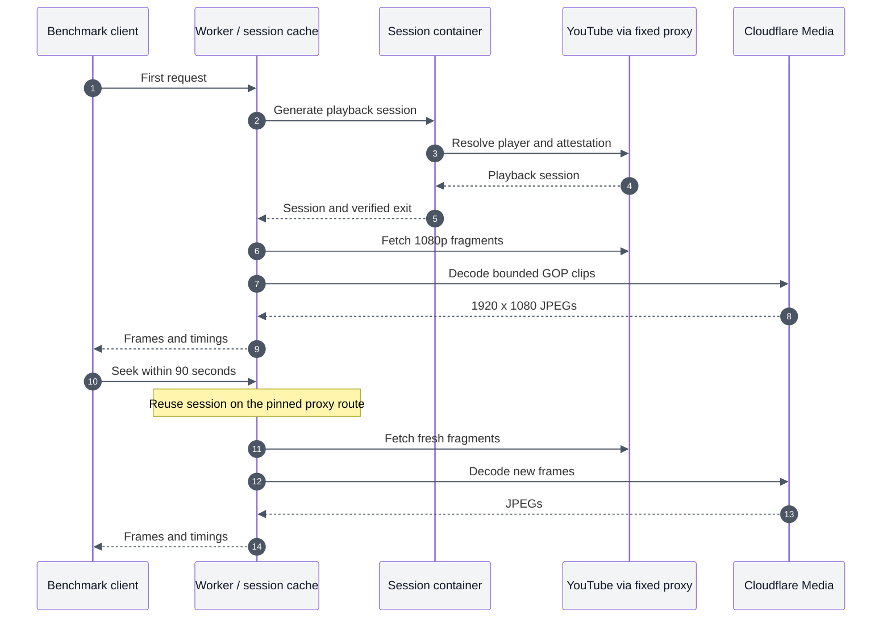

# Hosted container, Worker and Media experiment

This isolated benchmark generates an attested mobile-web playback session in a
Cloudflare Container, fetches H.264 1080p media through the dedicated proxy from
a Worker, and decodes short GOP clips using the real Cloudflare Media binding.
The developer machine only sends commands and receives the final images. It is
not a relay for session material or source video.

## Scope and measurements

- A: `ZmLg3_Bv2vY`, four frames at 14:05, 14:08, 14:12, 14:16, then one at 14:21.
- B: `aqz-KE-bpKQ`, one frame at 5:00, then one at 5:05.
- A first request always discards that video's session cache. A seek reuses it
  for at most 90 seconds, and only on the same configured proxy route.
- Both the container and Worker check the exit on a fresh session and compare
  it with the signed media URL. Seeks rely on the dedicated endpoint's fixed-IP
  contract; they do not independently measure the exit again. Changing the
  route, expiry, or an upstream failure invalidates reuse.
- Session, fetch/remux, decode and total timings are measured in Cloudflare.
  `clientMs` additionally includes ingress routing, response encoding, Internet
  transit and downloading the JPEG payload. It is not pure extraction time.
- Media decoding runs at concurrency two. There is no frame cache or 360p
  fallback. The Worker checks actual JPEG dimensions and source format 299.
- The container uses the production-sized `basic` instance (0.25 vCPU, 1 GiB).
  Its token provider and immutable public player JavaScript may stay warm.
  This harness does not share mobile client configuration across videos.

## Running

This is an experimental harness, not a production deployment configuration.
The Dockerfile deliberately builds on the exact local AMD64 image retained from
the preceding experiment, image ID
`sha256:32ed2dc1f3e4c1b728c7cdb81fbbdc83320df8c45b830d58570c30ee8f1cd466`.
That image must be available locally to reproduce this build. It includes the
pinned Node proof provider, yt-dlp, Python helper, and proxy transport. FFmpeg is
installed in that base image but is not invoked by this hybrid service.

Install the platform dependencies with `npm ci --prefix platform`, then the
benchmark's separate pinned streaming dependency with `npm ci --prefix
platform/benchmarks/frame-playback/hybrid` from the repository root. The
benchmark imports googlevideo through its public package exports and does not
require uncommitted changes to the production container package.

Deploy this directory's Wrangler configuration under a temporary Worker name.
Supply only `BENCHMARK_TOKEN` and `OUTBOUND_PROXY_URLS` through Wrangler secrets.
The latter must contain one dedicated Oxylabs endpoint as a JSON array. Do not
upload a complete environment file or put credentials in command arguments.

Set `HYBRID_BENCHMARK_URL` and `HYBRID_BENCHMARK_TOKEN`, then run `node run.mjs`.
The runner prints sanitized timing records and fails if HD, the expected path,
or session reuse is missing. The authenticated `/warm` route checks the HTTP
server only, without resolving YouTube or starting its token provider. Container
health therefore does not establish provider readiness.

Remove the temporary Worker, its secrets, container application and image tags
after testing. Raw sessions, signed URLs, proxy credentials and JPEG payloads
must not be included in saved result files.

## Validation

The narrow TypeScript check is `platform/node_modules/.bin/tsc -p
platform/benchmarks/frame-playback/hybrid/tsconfig.json` from the repository root.
Both JavaScript entry points also pass `node --check`.

A synthetic H.264 fixture with B-frames and a shifted 840-second source timeline
verified clip construction: the source frame and remuxed clip decoded to the
same raw-frame MD5. Real downloaded clips from all four routes also decoded in
FFmpeg and matched the returned Media images visually by SSIM (0.959 to 0.982
at the requested offsets). This validates decodability and approximate temporal
alignment, not bit-identical JPEG encoders or a guarantee of exact frame index
across decoders.

Sanitized observations, including startup failures, are in `results.json`.

## November 6 results

The hosted path returned 1920×1080 JPEGs for both videos. Three matched rounds
per video completed after the HTTP server and proof provider were ready. Each
first request resolved a fresh session; every matched follow-up reused it and
fetched new media. All successful media requests had HTTP 200 and stream
protection status 1. No successful sample used a 360p fallback or local relay.

| Video / request | Cloudflare extraction totals, seconds | Client totals, seconds |
| --- | --- | --- |
| A, first, four frames | 17.093, 17.532, 17.110 | 18.678, 18.563, 18.555 |
| A, cached seek, one frame | 5.795, 5.848, 5.841 | 6.559, 6.067, 6.581 |
| B, first, one frame | 15.137, 13.486, 13.040 | 16.707, 14.225, 13.798 |
| B, cached seek, one frame | 16.150, 2.097, 2.116 | 16.692, 2.629, 2.545 |

The final matched round separates the work as follows:

| Request | Session setup | HD fetch / remux | Media decode | Total |
| --- | ---: | ---: | ---: | ---: |
| A first | 10.445 s | 5.379 s | 1.286 s | 17.110 s |
| A seek | 0 s | 5.241 s | 0.600 s | 5.841 s |
| B first | 10.453 s | 1.208 s | 1.379 s | 13.040 s |
| B seek | 0 s | 1.385 s | 0.731 s | 2.116 s |

Session setup is the largest first-request cost. The actual player/proof helper
took 9.583–11.900 seconds in the matched rounds. Fresh exit verification took
0.629–1.264 seconds, overlapped with container setup, and was absent on cached
seeks. These timings exclude booting the container or its proof provider. They
also do not include the agent's reasoning, evidence persistence or answer.

For A, the final network trace received a 105-byte first response at 550 ms and
started its second request at 4,550 ms. The seek repeated the exact 4,000 ms gap
(560 ms to 4,560 ms). The googlevideo client applies the server's
`nextRequestPolicy.backoffTimeMs` before another request; the observed gap is
consistent with that mechanism, but the policy value was not captured directly.
For B, the final two calls each fetched all required media in one HTTP request.
Its earlier slow seek spent 15.555 seconds fetching/remuxing and only 0.595
seconds decoding. That outlier predates the finer network instrumentation, so
its precise cause is unresolved.

### Startup and rollout failures are separate observations

There were 20 extraction attempts in total: 13 returned HD frames and seven
failed during session setup. Of the 13 successes, 12 belong to the matched
rounds above. The remaining success was an uncached recovery request at A's
seek timestamp, taking 25.251 seconds; it is not counted as a cached seek.

- Initial container health checks timed out twice at 90 seconds while the
  control plane reported scheduling. A later health check succeeded.
- Three extraction attempts failed in the provider-startup stage because the
  existing provider helper only polls for five seconds per call. Subsequent
  requests succeeded after the same child process finished starting.
- During the image rollout, four extraction calls failed: two at the
  115-second request limit and two with container/session transport errors.
  No YouTube rejection was established by those failures. Responses also
  demonstrated deployment propagation: the root endpoint advertised revision
  3 while some Durable Objects still returned revision 2.
- After rollout completed, a new container became healthy in 1.768 seconds
  (1.518 seconds measured inside its container Durable Object). This successful
  attempt does not erase the preceding scheduling failures or establish a
  general cold-start bound.

The final hosted revision was `hybrid-3`, Worker version
`7156b499-0aa4-4d68-b0fd-1cb874e2c48f`. The first successful matched rounds used
`hybrid-2`, version `b0287d75-0634-4c3a-ba65-f9732bc3a6af`. The container used
image digests `b818a3a04c601d3ea6b2308efbca15f974123e6add3ef8d40c25994426e396be`
and `8bc72d8c27af7bd1b32eb00c35c99090e03ebf816d9bf1e18ff6bde9a39c246f`.

The retained server source corrects the startup polling loop to also recognize
Node's `AbortError` wrapping `TimeoutError`. The first deployed extension only
caught `TimeoutError` and therefore did not fix all startup attempts. The
corrected condition passed a local AMD64 test limited to 0.25 CPU: five polling
windows, ready after 21.483 seconds. This last correction was not redeployed or
validated on Cloudflare, and that local emulated timing is not a hosted latency
measurement. A production integration still needs cold-start/readiness handling
and rollout validation.

These results establish that container-generated sessions can drive Worker HD
fetching and Media decoding on the verified fixed proxy route. They do not
establish a production reliability rate, arbitrary-video support, a multi-exit
cache strategy or the fastest possible implementation.

Cleanup completed: the temporary Worker and its secrets, container application,
both remote image tags, and local benchmark auth file were removed. Production
was not deployed or modified by this experiment.
