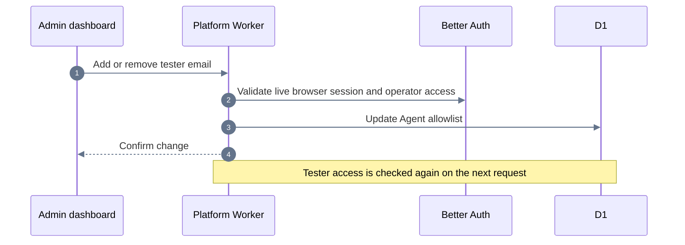
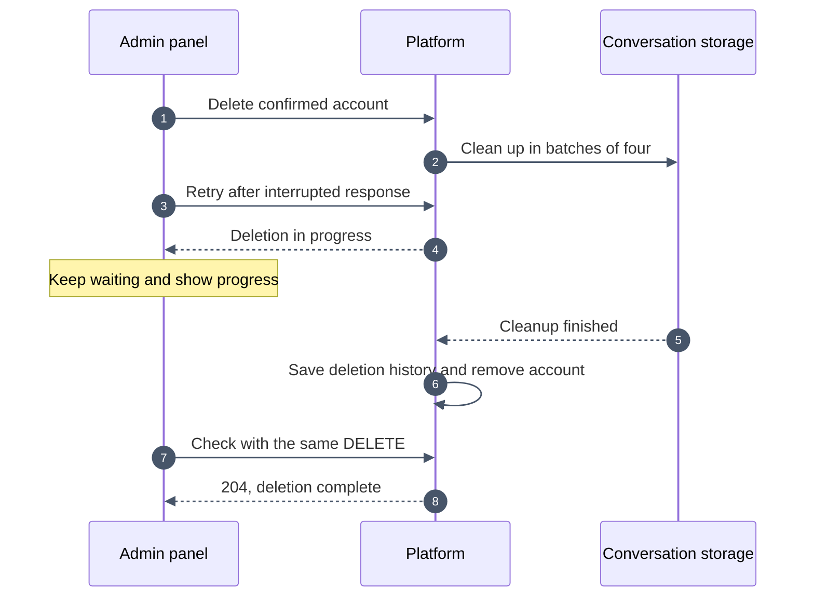

# Admin dashboard

Open **Dashboard → Admin** at `/dashboard/admin` to add, search, or remove Agent tester emails. It edits the existing D1 `agent_access_allowlist`; existing entries are preserved. The default `AGENT_ACCESS_MODE=all` allows every authenticated account, so tester entries do not affect Agent access. When explicitly configured with `AGENT_ACCESS_MODE=allowlist`, adding an email grants Agent testing access only. The account must verify its email, and its next dashboard refresh or Agent request picks up the change.

## Operator authorization

Better Auth's `admin()` server plugin and `adminClient()` client plugin are enabled. Migration `0016_better_auth_admin.sql` supplies their user and session fields. Existing users default to the `user` role.

Administrative access requires a live browser session and a currently verified, non-banned user who either has the Better Auth `admin` role or has an email in the existing `ADMIN_EMAILS_SECRET`. The latter is retained as a bootstrap path for existing operators. No new secret is required and no Agent tester is promoted automatically. To revoke an operator, remove both their admin role and any entry in the operator secret.

The shared gate bypasses Better Auth's session-cookie cache. Role changes, revoked sessions, verification changes, and bans are checked again on each administrative request. API keys, CLI bearer tokens, demo identities, and impersonated sessions cannot perform administrative operations. Ending impersonation remains available through the plugin's own session validation.

Native plugin endpoints under `/api/auth/admin/*` use the same browser-only gate. The current operator ID is passed to the plugin for that request only, allowing existing operator-secret accounts to use it without persisting an admin role. The built-in `/admin/remove-user` shortcut is disabled because it bypasses application billing, durable-state, and storage cleanup. The dashboard exposes Agent access management and application-owned user search and deletion.

The plugin enables account listing, creation and updates, role assignment, bans, session revocation, password changes, and impersonation through its API even though the dashboard has no controls for them. Treat both role-based and secret-based admins as trusted account operators. Admin status does not bypass billing limits or automatically grant Agent access, but admins can add themselves to the Agent allowlist.

## Application endpoints

| Method | Route | Purpose |
| --- | --- | --- |
| GET | `/v1/admin/access` | Check admin eligibility without listing accounts |
| GET | `/v1/admin/agent-access` | List/search tester emails with `q`, `limit`, and `offset` |
| POST | `/v1/admin/agent-access` | Add `{ "email": "tester@example.com" }` |
| DELETE | `/v1/admin/agent-access` | Remove `{ "email": "tester@example.com" }` |
| GET | `/v1/admin/jobs` | View recent jobs across accounts |
| GET | `/v1/admin/users` | Search active accounts and deletion history by ID or email |
| DELETE | `/v1/admin/users/{userId}` | Delete the confirmed account and its private data |

All responses are uncached. Mutations require JSON and an Origin matching `APP_ORIGIN`, in addition to the live operator check. Emails are normalized; adding or removing an entry repeatedly is safe. This also supports grants added directly in D1 with mixed case or spaces.

## Deletion retries

On October 21, 2026, a production deletion took 118.455 seconds. Its billing
preflight completed, then the application removed saved conversations sequentially.
Six conversation cleanup RPCs included calls lasting 34.281 and 40.203 seconds.
A second DELETE returned 409 at 18:43:23.986 IST while the first request was still
cleaning up. The first request returned 204 at 18:43:33.746 IST. Both requests used
the same account coordinator. The billing gate's boolean result conflated an active
deletion with an unresolved checkout, producing the misleading billing message.
The retained Worker logs do not establish why the browser retried or whether an
intermediary timed out. No checkout failure is needed to reproduce this incident.

The gate now returns a distinct admission result through `claimBillingDeletion`.
An active deletion returns `ACCOUNT_DELETION_IN_PROGRESS`; unresolved checkouts
still return `BILLING_OPERATION_PENDING`. The old boolean RPC remains compatible
with older Worker requests. Neither claim expires or permits concurrent cleanup.

The admin client retries the same immutable account ID every two seconds after
an in-progress response, a lost connection, or a gateway failure without an API
error code. It shows progress and waits for 204 before reporting success. After
two minutes it stops scheduling retries and asks the admin to check account status.
Leaving the page cancels client retries. Explicit billing, authorization, identity,
and cleanup errors remain visible. Backend cleanup can continue after a lost response.

Conversation cleanup runs in batches of four. Every started RPC settles before a
failed batch returns, preserving the deletion fence and registry for a later retry.
The account registry is cleared only after all conversations succeed.

### Cleanup latency

The two slow production RPCs used only 131 and 136 milliseconds of CPU. Most of
their 34.281 and 40.203 seconds elapsed while waiting. The retained logs have no
internal phase timings, and account deletion removed the trace records. They
cannot establish the original file count or separate storage waits from waits
for active agent work.

A regression test exercises the real account-cleanup method with an idle
conversation containing 40 completed tool calls and 80 private payload files.
With 10 milliseconds of injected latency per remote operation, the original code
took 1,419 milliseconds: 486 milliseconds publishing trace revocations and 930
milliseconds deleting files. It issued 42 individual D1 writes and 80 individual
R2 deletes. Batching only file deletion reduced that phase to 20 milliseconds;
the trace-index phase still took 489 milliseconds.

Cleanup now publishes revoked trace rows in D1 batches of at most 32 and deletes
R2 files in batches of at most 100. The same fixture needs two D1 batches, two run
summary writes and one R2 deletion, five remote requests instead of 122. These
measurements demonstrate accumulated storage round trips in an idle conversation;
they are not a reconstruction of the deleted production account.

Failed file batches remain in the durable deletion queue, and cleanup checks for
active file references before each batch. Failed trace publication retains its
outbox and stops account cleanup before clearing local records. Retry tests cover
both failures. The `agent_account_cleanup` event records counts and phase timings
for stopping active runs, settling credits, stopping memory work, draining tool
work, revoking traces, deleting files and clearing local state. It records success
or failure without prompts, file contents or credentials.

Deploy the platform before the web client to enable the new progress response.
This change needs no database migration. Validate in a nonproduction account with
slow cleanup; do not delete a production account merely to test the rollout.

## Testing and rollout

The admin integration tests use the Worker runtime and local D1 to verify the bootstrap operator, the admin plugin, role revocation, verified-email checks, bans, session revocation, origin enforcement, pagination, and Agent/admin isolation. Browser tests cover grants, filtering, removal confirmation, errors, unauthorized accounts, and mobile layout.

The normal production deploy command applies pending migrations first. Existing allowlist entries need no migration or reinsertion. Admin UI changes also require the frontend deployment. Production inspection during development is read-only; local tests must never add or remove production tester emails.
