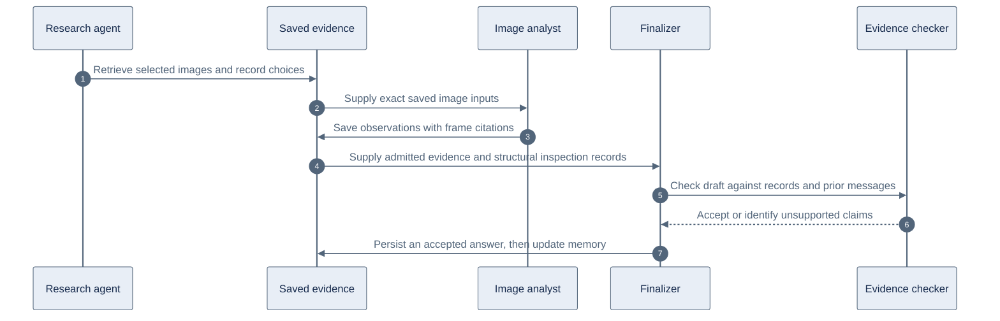

# Visual inspection and evidence checks

The hosted agent now records the difference between the images it received, the findings it reported, and the operations performed in the current turn. Follow-up answers use those records even when routed as conversation history only.

Our application controls tool access, saved evidence, frame mappings, answer acceptance and memory writes. YouTube supplies metadata, captions and storyboard images. Models choose inspection requests and interpret images. A model interpretation can still be wrong; the new check is a separate model review, not a mathematical proof of the answer.

## Workflow

The internal [visual-inspection skill](../../platform/src/agents/research/skills/visual-inspection/SKILL.md) is included when the research route allows visual evidence. It reuses adequate saved analysis, uses publisher timestamps or captions when they help locate a subject, and uses storyboard overviews when the location is unclear. Exact frames resolve small text, conflicting names or inadequate thumbnails. It does not require every visual question to fetch captions and storyboards.

For example, the replay used a 10-second storyboard grid. A supplied opening sheet contains both 3:20 and 3:30. An analyst mentioning one timestamp in a finding does not mean the other image was excluded. The application now lists every supplied image position separately from reported observation times. An answer that invents an exclusion or an undocumented selection reason can be rejected before persistence.

## Boundaries

- Exact-frame selection notes bind one reason to each requested timestamp. Locating references must have been delivered for the same video. Historical requests without notes remain readable; the agent must state that reasons were not recorded.
- Structural inspection records have a 12,000-character content budget. They contain image positions, coverage and operation labels, without image observations or caption text. They do not bypass paid evidence admission.
- Every substantive answer is checked, including history and context answers with no inspection records. Missing records cannot exempt a positive inspection claim. Clarification and rejected requests skip this review.
- The checker receives the same bounded evidence and prepared history as the finalizer. This includes transcript findings, support quotes, citation IDs, older history pages, attributed context reads and omission flags. Sharing the prepared projection adds no retrieval or evidence admission.
- The checker uses an independent, low-reasoning text model, at most 1,200 output tokens and 20 seconds within the existing answer deadline. It inherits the run's selected fallback and diagnostic callback, while keeping its own deadline and fallback transitions. Profiles with no configured fallback retain their primary model. Its cost uses the existing finalization category and run cost limit. The broader review scope adds a bounded model call to substantive answers that previously skipped checking. Inspection failures share the existing single answer-repair allowance. A rejected or unchecked answer is not persisted. Streamed text remains provisional until the checker accepts it.
- Context and unresolved-question memories store verified user quotes instead of generated paraphrases, including quote-only upserts with omitted or empty generated text. Findings still require nonempty text and admitted citations. Cited findings still rely on semantic grounding. Updater version 2 skips pending jobs from version 1; existing memory is not backfilled.
- `SKILL.md` is authoritative. The generated TypeScript bundle is checked by the platform build and regenerated with `npx tsx scripts/generate-agent-skills.ts`.

## Local replay

`npm run test:agent:visual-replay` in `platform/` is opt-in and makes paid model calls. Set `AGENT_REPLAY_ENV_FILE` to the local secret file, `AGENT_REPLAY_FIXTURES` to the saved public metadata/captions directory, and `AGENT_REPLAY_OUTPUT` to the replay asset/output directory. The latter contains `original-frames.json` and `public-storyboard.json` with local image paths. No credentials or images are committed.

The replay executes the four original questions sequentially with real Fireworks models, actual SQLite session storage and live memory updates. It separately challenges the checker with the original six-frame record, an empty record set, transcript findings without parallel excerpts and older attributed history. Synthetic challenge records are labeled in the replay and do not claim to reproduce the original transcript wording. It uses saved public provider responses, not production Durable Object execution or credit settlement. Worker integration tests cover those storage and billing boundaries separately.
