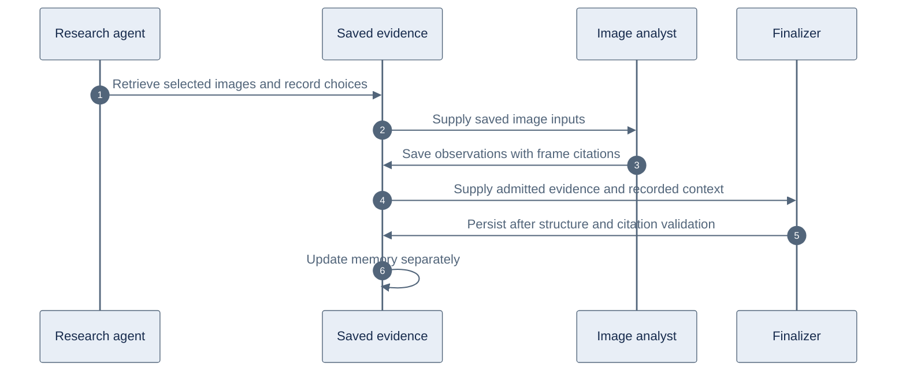

# Visual inspection and direct answers

The hosted agent records the images it received, the findings it reported, and the operations performed in each turn. Ordinary answers present findings with citations and material uncertainty. Recorded workflow details are used when the user explicitly asks how the answer was obtained.

Our application controls tool access, saved evidence, frame mappings, structured answer validation and memory writes. YouTube supplies metadata, captions and storyboard images. Models choose inspection requests and interpret images. There is no separate model-based inspection checker. Answer guidance and structural validation cannot independently prove that an image interpretation is correct.

## Workflow

The internal [visual-inspection skill](../../platform/src/agents/research/skills/visual-inspection/SKILL.md) is included whenever the research model has visual tools, so the guidance and the tools are always offered together. It reuses adequate saved analysis, uses publisher timestamps or captions to locate subjects, and uses storyboard overviews when the location is unclear. Exact frames resolve small text, conflicting names or inadequate thumbnails. New images are analyzed while they are saved by passing an analysis question to the retrieval tool. Captions and storyboards are retrieved when they help answer the question.

For example, if a user asks what the presenter holds at 3:20, the answer describes the visible object and cites that frame. It omits unsolicited statements about checking transcripts or inspecting frames. If the user later asks why 3:20 was chosen, the answer uses the recorded selection basis, such as a spoken introduction, and states when the reason is unknown.

A storyboard sheet can contain both 3:20 and 3:30 even when a finding mentions only one. Records distinguish all image positions supplied to the analyst from the timestamps in reported findings. That distinction supports workflow explanations without implying that an unmentioned tile was excluded.

## Boundaries

- Exact-frame selections bind one basis category to each requested timestamp: `publisher_timestamp`, `spoken_introduction`, `caption_mention`, `storyboard_overview`, `label_check`, `nearby_retry`, `user_requested` or `exploratory`. Every basis except the last two cites locating excerpts, which must have been delivered for the same video. There is no free-text reason, so a selection cannot carry source content. Free-text reasons saved before bases existed are dropped when read; those requests, like requests without selections, explain as reason unknown.
- Structural inspection records come only from the current turn and the earlier turns on its conversation branch: the frame and storyboard packets each turn produced or received. Other conversations that share the session's saved assets never contribute. Records have a 12,000-character content budget and contain image positions, coverage, operation labels and selection bases with their excerpt IDs, without image observations, caption text or free-text reasons, so they need no evidence admission. What a cited excerpt says reaches the answer only through admitted evidence.
- The finalizer writes the answer from prepared context. Existing schema, citation, budget and deadline checks remain. Invalid structured answers retain the existing single repair allowance. No additional reviewer model, reviewer prompt or semantic review rejection runs before persistence.
- Context and unresolved-question memories store the matching words from the user's question in the user's own letters, including quote-only upserts with omitted or empty generated text. Findings require nonempty text and admitted citations. Updater version 2 skips pending version 1 jobs; existing memory is not backfilled.
- `SKILL.md` is authoritative. The platform build checks its generated TypeScript bundle.

## Local replay

`npm run test:agent:visual-replay` in `platform/` is opt-in and makes paid model calls. Set `AGENT_REPLAY_ENV_FILE` to the local secret file, `AGENT_REPLAY_FIXTURES` to the saved public metadata/captions directory, and `AGENT_REPLAY_OUTPUT` to the replay asset/output directory. The latter contains `original-frames.json` and `public-storyboard.json` with local image paths. No credentials or images are committed.

The replay executes the four original questions sequentially with real Fireworks models, SQLite session storage and live memory updates. It checks that the initial visual answer omits process narration, explicit workflow follow-ups remain answerable, all four turns complete and no inspection reviewer call is made. Provider responses use saved public video assets. This is local orchestration, without production Durable Object execution or credit settlement.
