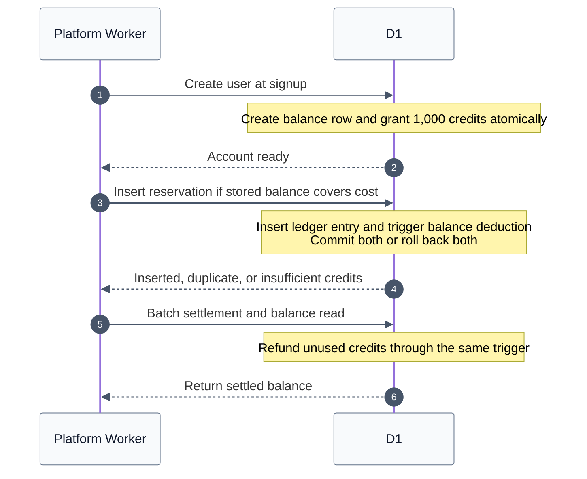
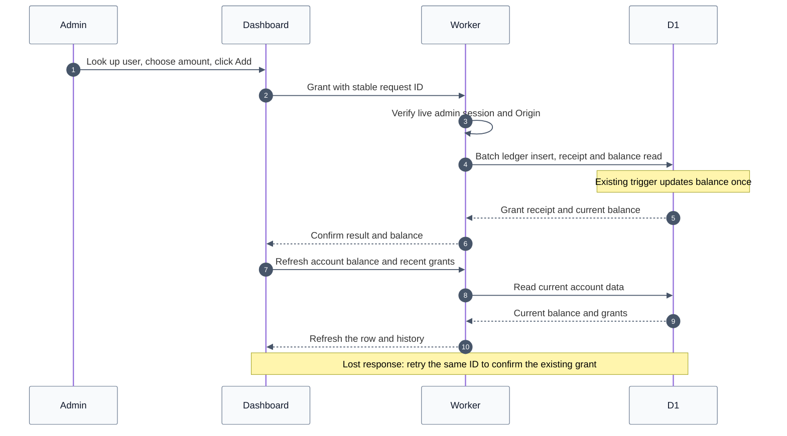
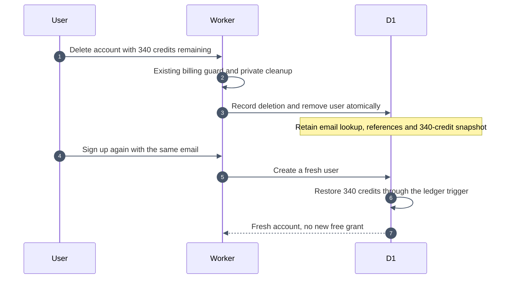
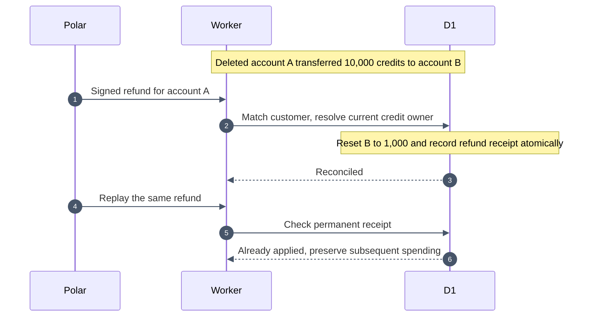

# Credit accounting

`credit_ledger` records every credit change. `credit_accounts.available_credits`
stores each user's spendable balance, including deductions for outstanding
reservations. Request-time balance reads and reservation checks use this single
account row, rather than summing the user's history.

The application inserts ledger entries. D1 triggers maintain the account balance
within the same SQL statement. There is no asynchronous synchronization or second
application write that can fail independently. Ignored duplicate ledger entries
do not fire the insertion trigger, so retries cannot apply the same change twice.
Payment webhooks retain their existing D1 batch, including billing state and the
processed-event record; the balance trigger participates in that transaction.



Concurrent reservations check the balance inside their conditional insert. A
successful reservation updates that balance before another write can spend it.
Do not move the sufficient-funds check into a separate application read.

Metered API requests reserve credits in one D1 call. Settlement and the resulting
balance read share a second D1 batch, so the remaining-balance header adds no
network round trip. Normal API and agent credit operations do not read the
billing plan or attempt onboarding grants. A standalone balance read is one
SELECT with no writes. See [stored video API latency](./API_LATENCY.md) for
measurements and response timing headers.

## Migration and rollout

Apply `platform/migrations/0017_credit_accounts.sql` before deploying the updated
Worker. The migration backfills all users from their existing ledger, including
zero and negative balances, and installs triggers for new users and ledger
inserts, updates, and deletes. It neither grants credits nor rewrites history.
The backfill is the one-time full-history calculation and should be budgeted for
when applying the migration to a large database.

Existing Worker versions remain compatible with the migrated schema: their
ledger writes also fire the triggers. A Worker rollback should retain the new
table and triggers. Preview and production migration/deployment scope must be
confirmed before changing shared state.

Apply `platform/migrations/0018_signup_credit_grant.sql` before deploying the
Worker that removes lazy grants. The standard `deploy:production` command runs
account migrations first. New user creation, the balance row, and the 1,000-credit
signup grant commit together. A grant failure rolls back signup so it can retry;
an account cannot be created successfully without its grant.

Migration 0018 also grants credits once to older Starter accounts that have no
`onboarding:v1` grant. It fills their balance to 1,000, preserves higher balances,
and skips Builder accounts. Already granted accounts are not refilled, even if
they have spent their allowance. Existing adjustments count toward this one-time
catch-up. The unique ledger operation prevents an old Worker from granting twice
during rollout. Retain the trigger on Worker rollback.

The SQL trigger uses the current 1,000-credit signup policy. Future allowance
changes must update the trigger in a new migration and update
`STARTER_ONBOARDING_CREDITS` together; changing the environment variable alone
only affects entitlement display and refund policy. Builder top-ups, refund
resets, and per-operation credit prices are unchanged.

## Manual credits

The dashboard’s Admin → Credits section looks up an existing account by user ID
or exact email. The selected account appears in a row with its current balance
and inline amount/Add controls. Operators can add 1 through 1,000,000 credits per
grant. There is no reason field or separate review screen. This does not change
the plan.

A successful grant immediately updates the displayed balance from its receipt,
then reloads the account balance and recent grants automatically. The amount
input clears after success so another grant needs a new selection. A failed
refresh preserves the confirmed grant and its returned balance; Refresh balance
retries only the read.

`GET /v1/admin/credits?user=…` returns identity, balance and the last ten dashboard
grants. `POST /v1/admin/credits/grants` takes `userId`, `requestId`, `credits` and
optional `reason` for compatibility with earlier clients. The dashboard does
not send a reason for new grants, but preserves the complete payload when
recovering an earlier unconfirmed grant. Both endpoints require a live verified
admin browser session; mutations also require the dashboard Origin. API keys
and CLI sessions are rejected.

Each grant stores the authenticated admin ID, reason and time in the existing
ledger. The request UUID is the ledger entry ID and forms its `admin-credit:`
operation ID. Retrying the same payload returns the original grant; reusing the
ID for a different recipient, amount, reason or admin returns 409. The insert,
receipt and balance read share one D1 batch. No new migration is needed.

The browser keeps an unresolved grant in session storage per admin until the
response confirms it or the server explicitly rejects it. After a connection
failure, reload or tab change, the row offers a retry with the original ID
and payload. Authentication errors retain that request because they occur
before the server can check an earlier grant’s receipt. A delayed completion
clears storage only if the saved request ID still matches its own, so an older
panel cannot erase a newer unconfirmed grant. The browser never automatically
submits the saved grant.



Append an `adjustment` to the ledger, with a positive integer to grant credits or
a negative integer to deduct them. Use a stable operation ID for retries of one
adjustment and a new ID for each distinct adjustment. Do not update
`credit_accounts` directly, and do not use `INSERT OR REPLACE` for ledger writes.
Use the existing unique constraint with `ON CONFLICT DO NOTHING` instead.

```sql
INSERT INTO credit_ledger (
  id, user_id, operation_id, entry_type, credits, metadata_json, created_at
)
VALUES (
  :entry_id, :user_id, :operation_id, 'adjustment', 10000,
  '{"reason":"Manual credit bonus"}', :timestamp_ms
)
ON CONFLICT(user_id, operation_id, entry_type) DO NOTHING;
```

Only insert this row. The trigger adds 10,000 to the account balance atomically.
New users already have their signup grant before any manual adjustment.

## Reconciliation

Run this read-only audit after migration or during maintenance. An empty result
means every user has a stored balance matching the ledger. It intentionally
scans history and does not belong on the request path. No recurring job is
installed by this change.

```sql
SELECT u.id AS user_id,
       a.available_credits,
       COALESCE(SUM(l.credits), 0) AS ledger_balance
FROM user AS u
LEFT JOIN credit_accounts AS a ON a.user_id = u.id
LEFT JOIN credit_ledger AS l ON l.user_id = u.id
GROUP BY u.id
HAVING a.user_id IS NULL
    OR a.available_credits != COALESCE(SUM(l.credits), 0);
```

Investigate any discrepancy before repairing the projection. Application
corrections should append ledger adjustments to preserve the audit trail.
Maintenance edits/deletes also update the projection, and deleting a user
cascades to both their account and ledger.

## Deleted-account credit continuity

Migration `0026_deleted_accounts.sql` replaces the signup grant trigger. A new
email receives the one-time 1,000-credit grant. A returning email receives an
`adjustment` with operation ID `returning-account:v1`, equal to the newest
recorded deletion's unclaimed carryover balance. Database insertion order, rather
than wall-clock timestamps, determines the latest record using a monotonic
sequence. Signup claims that snapshot for the new user ID in the same transaction.
The claim survives admin email changes. A signup using an already claimed email
snapshot starts at zero and cannot claim an older snapshot or another free grant.
Zero, negative and balances above 1,000 are preserved. Signup, the opening ledger entry and the projected account balance
remain one atomic D1 operation. Ordinary balance reads and reservations keep
their existing round trips. Builder subscription state is not restored.

`deleted_accounts` has one permanent row per original user ID. The final cleanup
batch snapshots the original email, signup time, Polar customer reference, plan,
remaining balance and self-service/admin actor before deleting the user. Both
commit or roll back together. A BEFORE DELETE trigger provides the same snapshot
for older Workers and direct D1 deletes, labelled `database`. Direct D1 deletion
still bypasses the subscription guard and private-storage cleanup and is not a
supported account deletion workflow. Retry after success cannot overwrite a row.

The credit snapshot is taken before cascading deletion changes the balance.
Outstanding reservations remain deducted; deletion does not manufacture a refund
for work whose final charge is unknown. Per-operation ledger rows and private
content still cascade or are cleaned normally. A stale settlement for a deleted
user cannot credit a new user with a different ID.

Email matching uses `lower(trim(email))`. It does not combine aliases, strip plus
suffixes, or remove dots. A database guard rejects simultaneous active accounts
with the same normalized email and rejects reuse of any deleted user ID. The
latter preserves the existing Durable Object deletion fences.

Apply the migration before the Worker. It changes no active balances and invents
no historical records. Previously deleted accounts whose balance and email
mapping were already erased cannot be reconstructed automatically. The pre-ledger
Worker remains compatible with these triggers; keep the migration on rollback.



Admin user search returns active and deleted rows together with stable pagination.
Historical balances are snapshots, not a live total after subsequent signups.
Only live verified admin browser sessions can read them. The table stores the
normalized email in readable form; it is retained identifying data, not an
anonymous record. The privacy page and both deletion confirmations disclose this
retention. Repeated deletion history is evidence of repeated accounts, not proof
of abuse by itself.

### Refunds after a credit transfer

`deleted_accounts.remaining_credits` is the immutable audit snapshot. The separate
`account_credit_carryovers` table holds the reconciled balance and the one-time
`transferred_to_user_id` claim. A successor's deletion creates the next node.
Refund ownership follows those user IDs, never the successor's current email.

A verified Builder refund matches the original Polar customer reference and user
identity. If no successor exists yet, it resets the unclaimed carryover to the
Starter allowance. If credits were transferred, it follows the chain and writes
an ordinary credit-ledger adjustment for the current live owner, or updates the
last unclaimed carryover if that owner has also been deleted. It never adopts the
old Polar customer or subscription into the successor account. Missing external
IDs on anonymized historic customers can resolve through the retained Polar ID;
conflicting checkout identity metadata remains rejected.

The reset, resolved owner, durable `account_credit_refunds` receipt and processed
event commit in one D1 batch. A receipt is keyed by order ID and survives user
cleanup, so replay cannot refill credits after spending or another transfer.
Ownership is resolved inside that transaction, eliminating a lookup/delete/signup
race. Permanent `account_credit_payments` receipts and previous refund receipts order
credit decisions. A stale refund cannot overwrite a newer recorded payment, while
a later cancellation or customer-state update cannot shield paid credits from a
refund. Live and deleted accounts use the same credit decision. Refund receipts
record whether the reset was applied, superseded by newer credits, or unnecessary
because no paid credits were granted. A skipped write is never recorded as applied.
Only a verified receipt allows a refund's processed-event marker to commit.

An applied refund also revokes Builder access in that same transaction. Later
active or cancel-at-period-end metadata cannot preserve paid access after the
credit reset. The update preserves customer/subscription details and the latest
metadata timestamp. Before downgrading, it rechecks the credit decision so a
replayed receipt cannot revoke a genuinely newer fulfilled payment. Replaying an
already applied refund repairs access left enabled by an older Worker without
resetting credits again. Builder-only deep imports use the resulting Starter
entitlements and return `BUILDER_REQUIRED`.

Migration 0026 preserves existing paid grants and applied refund entries before
user deletion can cascade their ledger away. A trigger also captures grants from
an old Worker during rollout. New grants retain Polar's event timestamp. Legacy
grants retain their local observation time, which is an upper bound rather than
an exact provider timestamp. They never inherit cancellation timestamps.

If a different legacy grant was observed after a refund's provider timestamp,
its order relative to that refund is unknown. The handler leaves credits and
billing state unchanged and returns a retryable error without a refund receipt
or new processed-event marker. The Polar webhook adapter currently returns HTTP
500 for handler errors. Replay the signed `order.paid` events for those grants,
then replay the refund. This fills in exact timestamps without granting credits
again, including after deletion and Polar anonymization. The refunded order's own
grant needs no ordering repair because payment precedes its refund. Legacy grants
observed before the refund are already known to precede it.

An already applied refund is not applied again after spending or transfer. An old
processed-event marker alone does not prevent recovery: replay repairs a matching
refund that an older Worker skipped while the user was live or deleted. Apply
migration 0026 before deploying the Worker, deploy promptly, and replay any
refunds acknowledged by the old Worker during the rollout. Unknown legacy event
timestamps are never silently replaced with billing-state timestamps.


