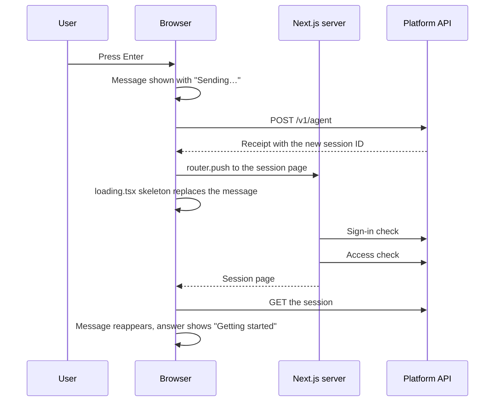
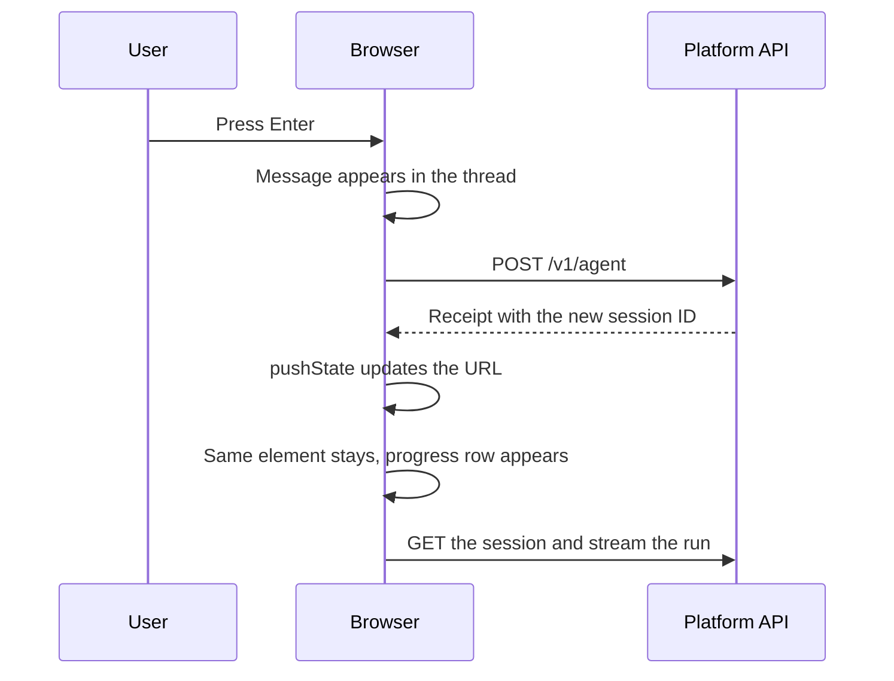
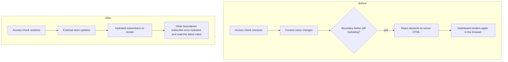
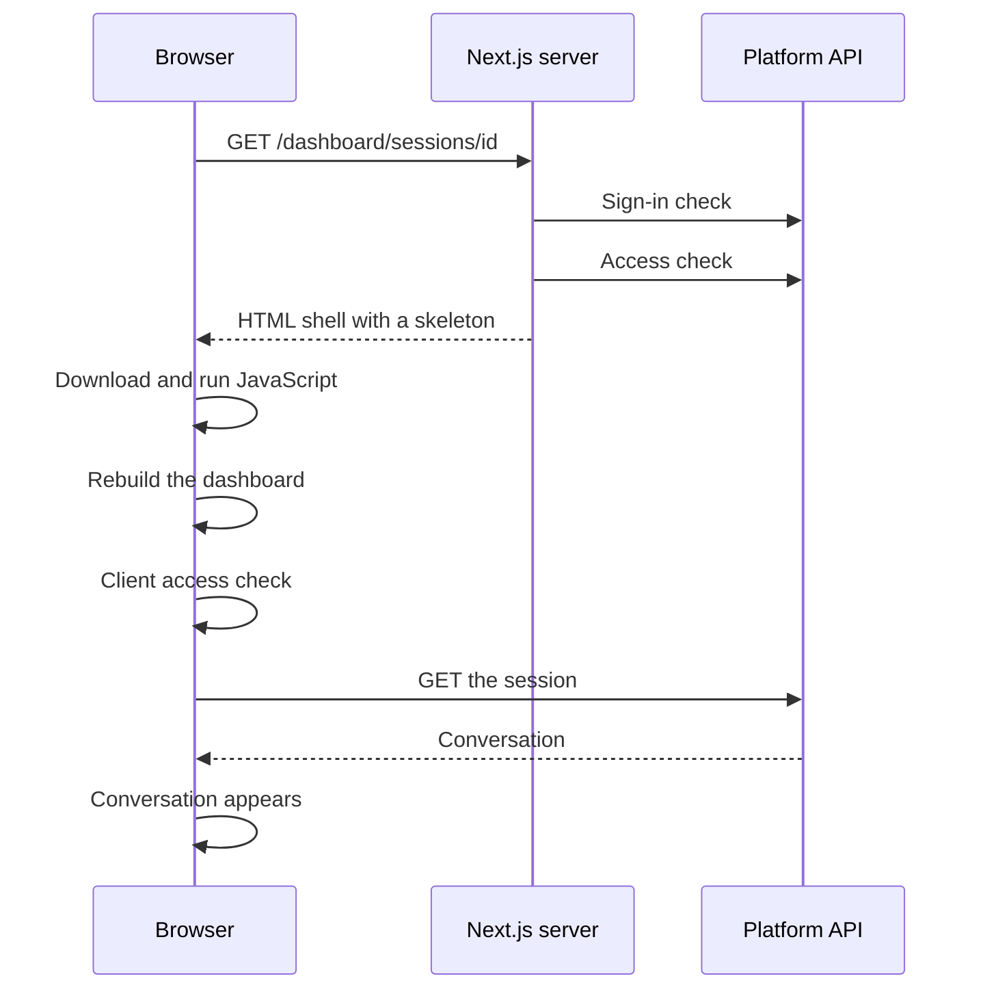
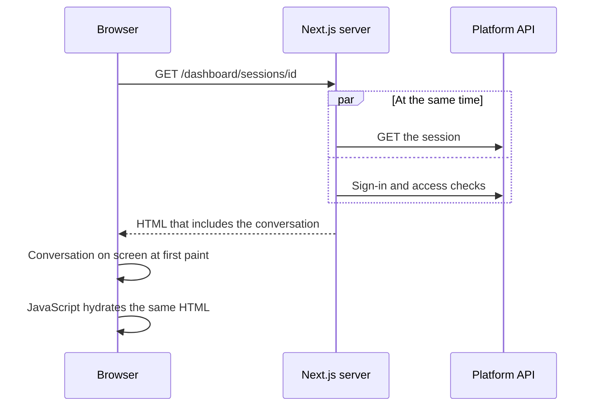
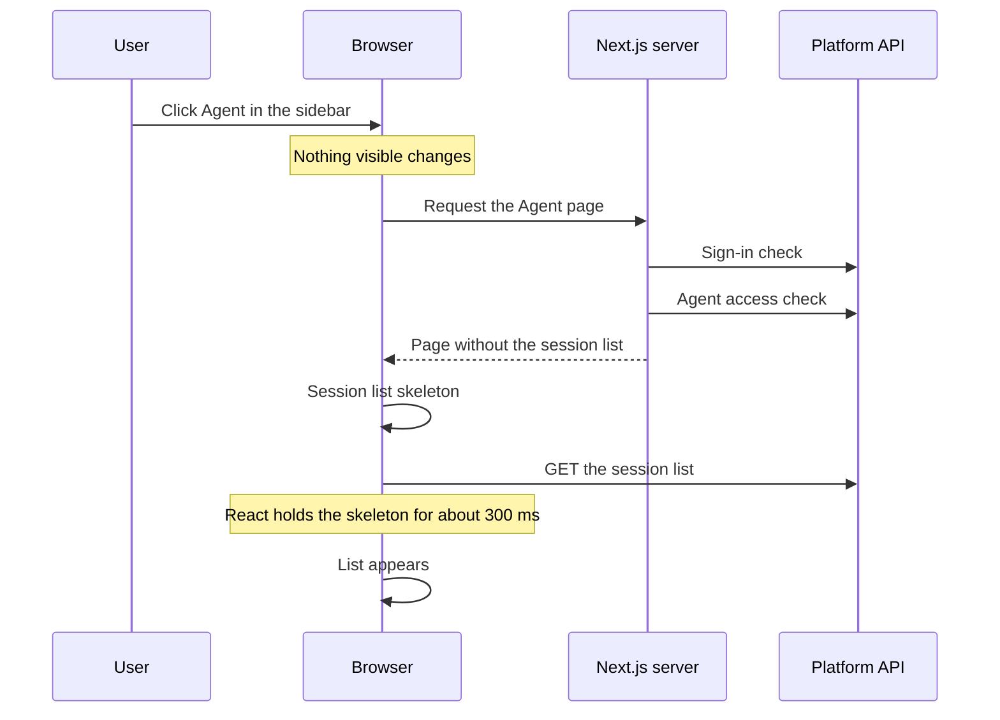
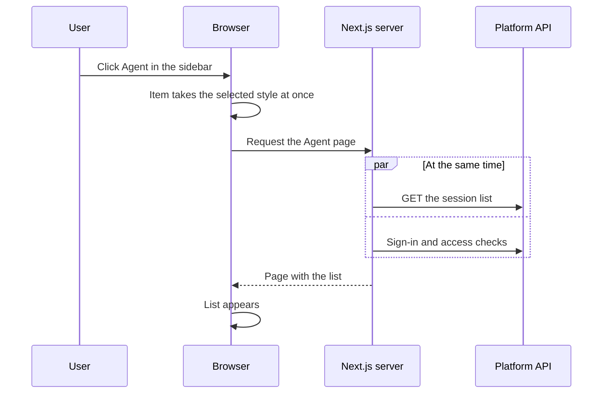
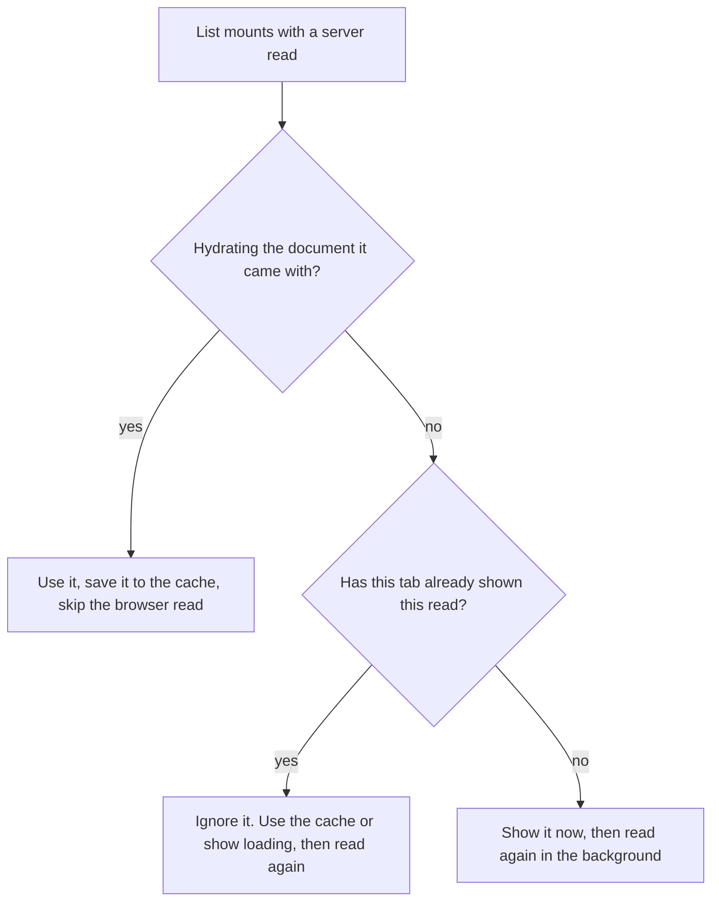

# How we made the dashboard feel instant

This is a write-up of three pull requests merged on 2026-10-17:

- **#207** made a sent Agent message appear instantly and stay put.
- **#209** stopped the dashboard from rebuilding itself on every load, and rendered the Agent conversation on the server.
- **#210** made moving between dashboard sections respond the moment you click.

It started with a small complaint. After you posted a question to the Agent, a loading state flashed before your message settled. Pulling on that thread turned up a bigger problem that affected every dashboard page. I've written this for engineers who are newer to React and Next.js, so it explains the mechanisms as well as the fixes. Every number comes from a measurement, and the last section explains how to reproduce them.

## The short version

| What | Before | After |
|---|---|---|
| Your message after pressing Enter | Shown with "Sending…", then replaced by a full-page skeleton for a new session | Appears at once and is never replaced |
| Answer before the first update | "Getting started" skeleton | A live progress row |
| Dashboard elements reused from the server's HTML | About 1% on most loads | 96 to 98% on Settings, Sources and Projects |
| Agent session, cold load on a phone profile | Conversation visible at 3,319 ms | 1,484 ms |
| Agent session, cold load on desktop broadband | 618 ms | 349 ms |
| First visible response to a sidebar click | Up to 980 ms | 0 to 8 ms |
| Returning to Agent on desktop | 416 ms | 65 ms |
| Agent → API keys on desktop | 332 ms | 114 ms |

## Part 1, #207. The message that wouldn't sit still

### What users saw

Starting a new session went like this. You pressed Enter. Your message appeared with a "Sending…" label under it. Then the whole thread vanished behind a skeleton, the message came back, and the answer area showed another skeleton labelled "Getting started". Follow-ups were better but still flickered.

### Why it happened

Three separate things stacked up.

**A route change after the server accepted the message.** Once the platform returned the new session ID, the code called `router.push('/dashboard/sessions/<id>')`. That page is rendered on the Next.js server on every visit, because it checks sign-in and Agent access. While the server worked, Next.js showed `sessions/loading.tsx`. That file is a full-page skeleton, and it replaced everything, including your message.



**A skeleton while the answer waited for its first update.** The answer component rendered a placeholder until the first live update arrived over the event stream.

**`useOptimistic` wired in a way that fought itself.** React's `useOptimistic` is the right tool for this. It shows a temporary value while an action runs, then drops it when the action finishes. The code kept the optimistic message as a separate element after the list. When the real message arrived, React saw a different element with a different key, removed the first and mounted the second. That remount also made the page scroll a second time.

### What we changed

We kept `useOptimistic` and used it the way it's designed to be used. The optimistic state now derives from the message list itself.

```ts
const [messages, addOptimisticMessage] = useOptimistic(
  session?.messages ?? [],
  (current, message: AgentMessage) => [...current, message],
);
```

When the server confirms the message, the real message renders under the same React key as the optimistic one. React sees the same element and reuses the DOM node, so nothing remounts, nothing scrolls twice and focus stays where it was. If the server rejects the message, the action ends, React drops the optimistic entry on its own, and the draft goes back into the composer with the error.

For new sessions we stopped navigating. The thread stays mounted and only the URL changes.

```ts
window.history.pushState(null, '', `/dashboard/sessions/${sessionId}`);
```

`pushState` is a browser API. It changes the address bar and adds a history entry without making a request. Next.js listens for it and updates `usePathname()`, but no server code runs. The session itself is still created by the platform API, exactly as before. What we skipped was a server render that would have shown the browser data it already had.



The answer area now shows its progress row from the moment the run is admitted. The first live update only changes its label.

### What review caught

If you pressed Back before the server confirmed the first message, the late confirmation still called `pushState`. You'd be looking at Sources while the URL said you were in a session. The fix checks three things before changing the URL. The thread must still be mounted, it must still be the current one, and the URL must still be the sessions home. Otherwise the new session simply appears in the session list and you stay where you went. That's better than the old behaviour, which yanked you back into the session.

## Part 2, #209. The dashboard that rebuilt itself on every load

### A quick primer on hydration

When you load a dashboard page, the Next.js server sends finished HTML, so you see the page before any JavaScript runs. Then React loads in the browser and *hydrates* that HTML. It walks the existing DOM, attaches event handlers and takes ownership of it, without recreating anything.

React hydrates in pieces. A `<Suspense>` boundary marks a section that can arrive or hydrate later. Until React gets to a boundary, that boundary is *dehydrated*. Its HTML is on screen, but React hasn't attached to it yet.

If React can't reconcile what it expects with the HTML it finds, it gives up on that section, throws the HTML away and renders the section from scratch in the browser. That's correct but wasteful. The user gets the server's HTML, then the same content built again, and anything they clicked in between is lost.

### How we found it

We set out to render the Agent conversation on the server, so it would appear before the JavaScript loaded. The first prototype got faster, but a probe showed the server's HTML was never reused. The heading on screen at the end was never the one parsed from the HTML.

So I tagged every element present while the browser was still parsing the document, then checked which elements on screen still carried the tag after load. The homepage and login page kept 98 to 99% of theirs. Every dashboard page kept about **1%**, on 24 of 25 cold loads on `main`. The whole dashboard, sidebar included, was being rebuilt in the browser. The exception was always the first request after a server start, which turned out to be the most important clue.

### Why it happened

The dashboard layout passes server data to the browser as pending promises: the access check, projects, usage, billing and notification settings. On the first request after a server start, those promises resolve late and arrive in a separate chunk. On every later request the server already has them, so they arrive already resolved.

When the access check was already resolved, `DashboardSessionProvider` applied it right away by changing React context. That update landed while parts of the dashboard were still dehydrated. A context change has to reach every component that reads the context, and React's way of handling that for a dehydrated boundary is to discard its HTML and render it fresh. It reports no error when it does this. I tried applying the update as a transition and as a synchronous update, and neither helped. A context change into a dehydrated boundary forces the rebuild either way.

The Agent pages had a second, separate cause. `AgentSessionCacheProvider` keyed its subtree on `agentAccess`. Before the check, `agentAccess` is `false`. When the check flips it to `true`, the key changes and React remounts the entire Agent view on purpose.

### What we changed

Access moved out of context and into a small external store. Components read it with `useSyncExternalStore`.

```ts
const access = useSyncExternalStore(store.subscribe, store.read, () => accessBeforeCheck);
```

This works because of how React treats subscribers in a dehydrated boundary. The components inside it don't exist yet, so they aren't subscribed and the update can't reach them. Each one subscribes once its boundary hydrates, reads the current value and re-renders normally. The context value itself no longer changes, so nothing forces a rebuild. The data loads in `DashboardDataProvider` already worked this way, which is why they never caused the problem.



The session cache now resets only when access is actually withdrawn, so the first check after load no longer remounts the Agent view.

After the fix, Settings kept 98% of its server elements, Sources 96% and Projects 97%. The Agent session page kept about 75%, and the rest is content that only renders in the browser, such as local times and per-answer sources.

### Rendering the conversation on the server

With hydration working, the session page could finally use its server-rendered conversation. Before, a cold load was a long chain of waiting.



Now the page starts reading the conversation while it checks sign-in and access, and renders it into the HTML.



Median of 8 cold loads, compared with #207:

| Profile | Conversation visible | Largest contentful paint |
|---|---|---|
| Phone: 150 ms round trip, 1.6 Mbps, CPU 4× slower | 3,319 → 1,484 ms | 3,344 → 1,554 ms |
| Desktop broadband: 40 ms round trip | 618 → 349 ms | 640 → 378 ms |
| Localhost, no throttling | 138 → 337 ms | 168 → 366 ms |

The localhost row got slower, and the reason is worth knowing. React 19.2 keeps a Suspense fallback on screen for about 300 ms once it has appeared, so a skeleton doesn't flash. Before the fix, the browser rebuild happened to skip that wait, but only on localhost, where JavaScript loads in a few milliseconds. On any real connection the first paint already takes longer than 300 ms, so the hold never shows.

### Details that mattered

**Message times.** The server doesn't know the reader's timezone. Rendering a time on the server would print the server's timezone and then fail to hydrate. Times now render empty in the server HTML and fill in once the browser takes over, through a small `useHydrating()` hook built on `useSyncExternalStore`.

**Typing before hydration.** The composer is now part of the server HTML, so on a slow phone you can see it before React owns it. Typing there could be lost, and Enter would insert a newline instead of sending. The composer stays read-only until it hydrates.

**Back must not show an outdated conversation.** Review found that pressing Back restored the page as it was first rendered. If you'd just completed a follow-up, it disappeared. The fix trusts the server's copy only while hydrating the document it arrived with. Back, Forward and in-app navigation show the restored copy straight away, then fetch the conversation and merge in anything newer.

**The skeleton had drifted.** The loading skeleton for a session was capped at 660 px and pinned left inside an 800 px column, so it looked skewed. Its answer lines also ignored the avatar column, it had no "All sessions" row or assets panel, and on phones it used the wrong padding. It's now a copy of the thread layout. I checked it by measuring each block's position against the real content at desktop and phone widths.

## Part 3, #210. Clicks that did nothing

### What users saw

Switching sections felt slow, most noticeably from Agent to API keys. Measurement showed three causes.

**Dead clicks.** Sidebar links don't prefetch, which was a deliberate decision in #77 to avoid loading private pages nobody opened. So nothing on screen changed until the server answered, which took 100 to 200 ms on desktop and up to almost a second on the phone profile.

**Skeletons held on screen.** This is the same 300 ms hold from Part 2. Agent → API keys hit it because a "Manage API keys" link on Settings quietly prefetched the API keys loading screen. Returning to Agent hit it too, because the page arrived without its session list and the browser showed a second skeleton while it fetched one. The server only needed about 100 ms, but the skeleton stayed for 300.

**Server checks in sequence.** Every page checked sign-in before it started reading its data. Agent pages checked sign-in, then access, then sent the page.



### What we changed

**The click registers immediately.** Each sidebar link renders a small element that reads Next.js's `useLinkStatus()`. While a link is pending, CSS `:has()` moves the selected style to it and takes it off the current page's item. If loading takes longer than 150 ms, a dot on the item's icon pulses. The element is always rendered at a fixed size and only changes opacity, so it can't shift the layout, and it respects reduced motion. Nothing is prefetched, so #77's rule still holds.

**Server work runs in parallel.** Section pages start their data reads before awaiting the sign-in check. Agent pages run sign-in and access with `Promise.all`.

**The Agent session list arrives with the page.** The home page reads its recent sessions on the server, in parallel with its checks, so there's no second skeleton.

**The Agent home has its own skeleton.** It used to borrow the conversation's skeleton. Now it mirrors the welcome title, composer, search field and session rows, and I measured it against the real page the same way.

**No more prefetched API keys skeleton.** The links to API keys inside Settings and Sources no longer prefetch its loading screen.



### When can you trust data the server sent earlier?

This question came up twice, and the rule we ended up with is the most reusable idea in this work. Data rendered into a page is a snapshot, and browsers replay old snapshots all the time.

- **A fresh document load** brings data the server read for this request. It's current.
- **Back and Forward** restore the page exactly as it was first rendered. That can be minutes old.
- **Prefetched pages** can also be minutes old by the time someone clicks.

Review found that once you left the Agent section, its in-memory cache was discarded. Pressing Back then brought back the list from the original page, and if the next request failed, that outdated list stayed on screen. Each server read of the list now carries a unique ID, and the tab remembers the IDs it has shown.



The conversation follows a simpler version of the same rule. A restored copy is shown at once and the browser always fetches and merges the latest messages.

### Results

Median of 5 runs. The test API adds 40 ms to every call, to approximate the gap between the web host and the platform. "Ready" means the destination is on screen with no skeleton. The click-response row leaves out one revisit that Next.js already served from its cache in 3 to 5 ms.

| Switch | Desktop, `main` → now | Phone profile, `main` → now |
|---|---|---|
| First visible response to the click | 32 to 202 ms → 0 to 1 ms | 42 to 980 ms → 1 to 8 ms |
| Agent → API keys | 332 → 114 ms | 342 → 377 ms |
| Returning to Agent | 416 → 65 ms | 365 → 221 ms |
| API keys → Agent | 415 → 65 ms | 362 → 213 ms |
| Sources → Agent, first visit | 264 → 215 ms | 1,166 → 996 ms |
| Settings, Projects, Sources | unchanged | unchanged |

On the phone profile, Agent → API keys now finishes about 35 ms later. It waits for the real page instead of flashing a prefetched skeleton, and in exchange the click is acknowledged at 1 ms instead of 42. I think that's the right trade, but it is a trade.

Exploring Sources didn't change, and that's an honest finding rather than a gap. Searching, opening a result and going back make no server page requests. Their time is almost all provider response time, so the next gains there would have to come from the YouTube side.

## What I'd tell a junior developer

**Measure before changing anything.** The lag was real, but every intuitive explanation I had was wrong. Each cause in this article was found by a probe that recorded what actually happened.

**A skeleton isn't free.** React holds a shown fallback for about 300 ms, so on a fast connection a skeleton can make a page slower than showing nothing. Show one when the wait is genuinely long, not by default.

**Context changes during hydration rebuild the page.** If a value changes right after load, deliver it through an external store and `useSyncExternalStore`, not through context.

**Server-rendered data is a snapshot.** Treat anything that arrives with a page as current only while hydrating that page. Restored and prefetched pages need revalidating.

**Keep React keys stable for things that should stay on screen.** If the optimistic version and the confirmed version of an element have different keys, React will remount it, and the user sees it.

**Flaky tests can be telling you something.** Several tests started failing once hydration worked, because they clicked before React had attached its handlers. The rebuild had been hiding that window. The fix was to wait for hydration in the tests, and to make the real composer read-only until it's ready.

## Reproducing the numbers

All numbers are lab measurements from local production builds against the repository's test API. They're consistent between runs, but they aren't field data.

- `platform/test/agent-session-performance.mjs` measures cold loads of a session page. It also checks whether the server's HTML was reused and counts browser requests for the session.
- `platform/test/dashboard-navigation-performance.mjs` measures sidebar switches and the Sources flow. It records the first visible feedback and the time until the page is ready, and counts the platform calls the server makes on each switch.
- Set `FIXTURE_LATENCY_MS=40` on the fixture server to add API latency. Tests run without it.
- `platform/test/e2e/support/hydration.ts` gives e2e tests a way to wait until React owns the page.
