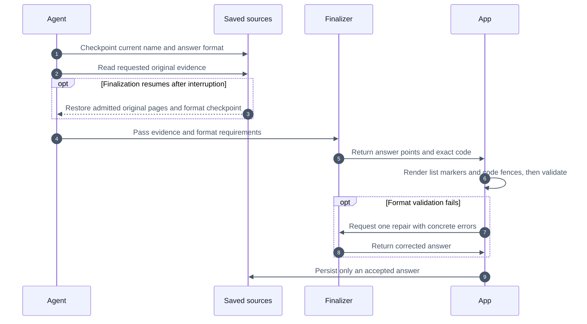
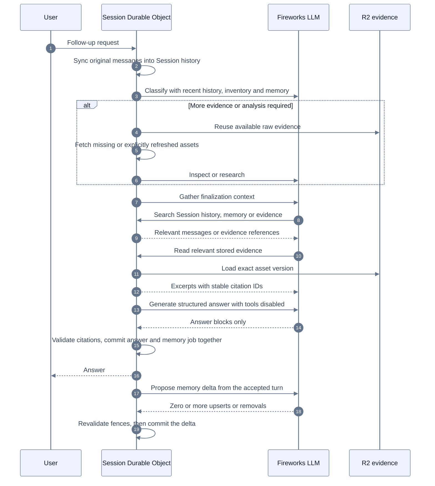
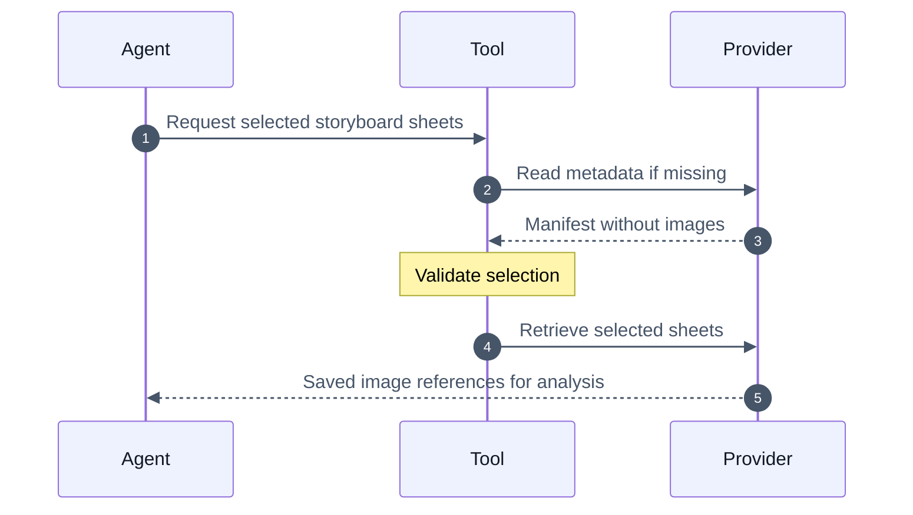

# Session evidence and memory

The existing conversation-scoped AgentRuntimeDO owns source availability and derived memory. Cloudflare Agents Session provides searchable conversation history and the model-facing searchable-context tools. The shared D1 catalog locates immutable public source versions in R2; the session keeps ownership, citations, search projections and private analysis. Fireworks performs classification, analysis and finalization; it does not own persistence or retrieval policy.

Descriptions are retained as separate citable excerpts of at most 2,000 characters, without the generic 800-character model projection cut. Historical metadata retains descriptions within a combined 48,000-character snapshot budget. Model-facing transcript analyses retain title, channel, caption provenance and supported entity quotes, but omit the repeated full description. The original description stays in saved evidence and its separate citable metadata packet. This keeps publisher prose from displacing completed findings. Finalization still applies its overall evidence budget and reports omitted context. Existing saved answers and analyses are not rewritten. Older metadata without a retained description can be loaded again before new analysis.

## Analysis availability and read timing

Frame, storyboard and transcript analysis obtain their saved inputs once. Before loading,
they capture the session's SQLite deletion generation. After loading and again after
inference, they synchronously check that the generation is unchanged and every selected
asset row still exists. The post-inference check does not read D1 or R2. Deleting and
retrieving the same version during inference cannot restore that in-flight analysis.
Any generation change fences the analysis, including deletion of unrelated evidence or
memory. Normal retrieval and refresh do not advance the generation.

Storage reads still verify the shared catalog payload; cache hits reuse a snapshot
verified earlier in the run. The final check establishes
session availability only; it does not detect a shared catalog version or R2 object
removed during inference. Shared sources currently have no deletion or retention policy.
A future shared-source deletion feature must revisit this boundary.

`agent_operation` logs with `stage=analysis_asset_read` measure the wall-clock time to
load and validate the selected input batch, including session checks, catalog lookups,
R2 downloads and payload hydration. Each event carries `runId`, `toolCallId`, asset kind,
count and outcome, with `elapsedMs` on completion. Concurrent reads contribute their
batch duration, not the sum of individual read durations. These logs contain no source
payloads. They are separate from inference timing. A cache hit still appears in this
stage because the session checks and snapshot decoding run before inference.

## Run-scoped analysis cache

Each execution of a research run owns a separate cache for transcripts, frames and
storyboard sheets. Retrieval seeds it only after persistence or a verified session read
returns a single immutable asset version. Analysis reuses that exact payload while
checking current session metadata, ownership, duration limits and deletion generation.
Explicit refresh still retrieves fresh evidence; older versions retain their own cache
entries and current/superseded status comes from SQLite. Billing still passes through
`deliverSavedAssets` and the existing per-run ledger.

The cache retains at most 64 entries and a 16 MiB snapshot budget, using twice each JSON
string's character count plus its version key and an entry allowance. This is a bound
on retained snapshots, not the whole Worker heap or transient serialization/model memory.
Oversized assets bypass it. Least-recently-used entries are evicted and fall back to the
normal verified D1/R2 read. Snapshots are serialized once on admission and decoded on each
hit so mutation by one caller cannot change another analysis's input. This trades local
serialization work for fewer remote reads; production latency remains to be measured.

The cache belongs to one session-store instance and one execution. Completion, failure
and cancellation clear and close it, so late work cannot refill it. Concurrent runs do
not share it. A resumed run starts empty. A deletion generation change invalidates all
entries before reuse; missing session rows still fail. Cache hits trust the source
verification performed earlier in the same run, so shared catalog/object removal or
corruption during that run is not detected until the next storage read. The current
shared catalog has no deletion policy.

For three retained inline frames, retrieval followed by analysis makes zero additional
analysis-side D1/R2 reads. A later run analyzing those saved frames loads each once and
can reuse them for another internal analysis call while answering that same user message. A new user message starts a new run with an empty cache. Retrieval still waits for persistence;
the cache alone does not defer writes or change preview ownership. Optional combined analysis uses the pending-input path described below.

## Retrieval and analysis in one call

`get_video_transcript`, `get_video_frames`, and `get_video_storyboard` accept an optional
`analysis` question. It participates in the durable tool key, so different questions
cannot reuse the wrong findings. `research_video_transcripts` uses this path for
video IDs and keeps standalone analysis for supplied saved versions.

The private request-coordinator RPC can notify each caller when the requested
content is available, before its catalog writes finish. Callers sharing extraction
receive their own notification. Callback failure does not fail another caller’s
save. The session provider combines existing session hits with extracted misses
before notifying the analyst. Public data responses still wait for persistence.

The combined tool validates selection, video identity, transcript completeness,
duration and image limits before inference. It captures the session deletion
generation and compares a hash of the analyzed content with the final persisted
response. Pending bytes never enter the saved-asset cache. Only successful session
attachment makes references eligible for returned findings. Cancellation or a save
failure aborts and observes outstanding inference; deletion or mismatched content
rejects the result. If inference alone fails, the tool returns the saved retrieval
with `RETRIEVAL_ANALYSIS_FAILED`, preserving its usage and saved asset versions.
Batch research includes the saved transcript version in its failure response. A
new call ID with the same question retries through the standalone saved-analysis
tool, without calling the retrieval provider or charging the source again. A repeat
of the original completed call ID remains idempotent. Successful saved analysis is
reused on subsequent retries. Deletion and cancellation still reject unavailable
inputs. Failed analysis records allowlisted error classification, request ID when
available, run ID and tool-call ID; raw provider errors are not added to the packet.

Preview saving starts after source persistence and runs alongside any unfinished
inference. The tool waits for both before returning. Preview failure preserves
successful findings with a warning; cancellation still drains inference. Each call
tracks its newly written previews until the final evidence packet is published.
If deletion, cancellation, changed content or publication failure rejects the call,
cleanup drains outstanding preview writes and removes its unpublished private
objects. Failed deletions remain in the session cleanup queue for retry on restart.
Shared catalog images are retained. Saved analysis validates its final warning list
after adding the superseded-version warning and keeps at most 50 warnings.

The retrieval’s existing maximum-price credit hold covers the combined operation.
Its single returned usage entry settles through the existing ledger; no nested
saved-analysis delivery adds another charge. Model usage is still recorded by the
analyst. A failed save can waste inference work and does not produce a successful
evidence packet. All provider calls share four retrieval slots, including combined
calls and metadata lookups. The slot ends when the provider returns, before the
tool waits for inference. Ready inputs enter the existing inference limiter, while
saved-analysis tools separately bound payload reads. Slow extraction cannot occupy
analysis slots, and metadata never waits on an enclosing tool that holds a retrieval
slot until analysis completes. When temporary holds leave too few credits, required
tools wait without holding credits or provider slots. They recheck cancellation,
deletion and the durable tool quota before starting. A request that cannot fit even
after other holds clear fails immediately. Optional nested metadata lookups remain
nonwaiting so they cannot wait on their own parent’s hold.

`combinedTimingsMs` records retrieval completion, inference duration, their overlap,
and total tool work. The early private RPC notification transports the input once
before the final response, adding serialization and transport work. The run cache
remains bounded; an active combined call owns its inputs until completion regardless
of cache admission. Unit tests and a local Workers RPC test verify ordering, failure
handling and saved-reference publication. Opt-in Fireworks tests use synthetic
transcripts and chart images with a delayed simulated save. These establish working
inference and overlap, not a production latency improvement.

## Original saved captions and comments

`read_saved_evidence` reads an immutable session asset version directly. It supports literal-word search, caption time ranges, and offset pagination. Each result contains up to 30 excerpts within a 12,000-character excerpt budget, with selection counts and a continuation offset. Captions retain their original segment times. Comments retain author, comment ID and saved position, including saved replies and long comment tails. Search never combines different comments. It does not call YouTube or an analyst.

Exact-quotation and correction requests use this reader before research completion. Selected original passages remain verbatim in finalization even when a complete analyst summary exists for the same version. A page that cannot fit the prompt is disclosed as omitted, never silently shortened. Immutable excerpt IDs continue to resolve after reopening. Run recovery joins saved original pages to that run’s admitted-delivery ledger and rechecks current ownership. This restores the exact pages already charged for without rereading assets, calling providers or charging again. Undelivered pages, other runs’ deliveries and deleted assets are excluded. These reads use normal evidence admission and per-run asset billing, so rereading the same version does not charge it again in that run.

For saved-only text verification, the classifier selects the runtime skill `verify_saved_evidence`. Its research workflow covers source selection, focused reads, pagination, exact quotes and calculation premises. Before original reads, `set_verification_requirements` records a bounded list of resolved user requirements and a structured answer format. The format contains the latest user-specified name, numbered point count, whether only those points are allowed, and whether code must be fenced. The name must occur in a supplied user message. The finalizer receives this record on normal completion and when the research deadline interrupts the run. The record is checkpointed in the existing run research-context JSON before the requirement tool acknowledges success. Finalization recovery restores the same structured constraints, including validation and repair, instead of relying on prompt text alone. Later history reads and memory reconciliation preserve that checkpoint. It is task context, not source evidence. Saved visual follow-ups carrying the verification skill record the same requirements while retaining their visual tools.

The finalizer constrains the number of blocks when the user requests only numbered points. The application renders sequential list markers from those blocks, preserving their wording and citations. When code fences are required, the model supplies a separate `codeBlocks` array with exact code, language and a zero-based target point. The application inserts fences inside that point, using a delimiter longer than any backticks in the code. These fields are internal to finalization; the public answer format is unchanged.

Before acceptance, both generated blocks and the blocks after citation rendering are validated. Missing inline references on numbered points that end in code are inserted into the point’s opening prose, preserving the code and avoiding an extra Sources paragraph. The application checks the current name in prose, sequential numbering, absence of extra heading/closing blocks, and nonempty closed code fences when requested. Code contents do not count as answer points or as the note name. Other violations use the existing single repair attempt, with the validation errors repeated next to the latest request. If repair fails, the run reports a failure rather than publishing an unformatted evidence fallback. This enforces the recorded format; it does not prove the model resolved every preference correctly or semantically fulfilled every requested item.

General discovery and analyst tools are excluded for text verification. Normal completion requires admitted original text from every requested available source, including when the request also retains visual observations. This source-level gate does not prove that every requested claim is supported. Selecting the verification skill implies saved-only access even if the classifier omits that companion flag. The skill permits at most 16 original reads within a 120-second research window. The previous 40-second text window could expire after requirement recording and only two reads. Existing persisted deadlines, model-cost limits and evidence-credit limits remain authoritative; ordinary text research keeps its 40-second window. Deadlines still hand off with explicit missing-source gaps. Queries match every word literally within a comment or nearby captions, without stemming or semantic synonyms. The reader and skill direct the agent to start with one distinctive word from requested wording and simplify empty queries before claiming absence.

The classifier records `savedOnly` when fresh retrieval is prohibited. Research then removes retrieval/discovery tools and uses a rejecting upstream provider beneath session reuse, including for incidental analyst metadata calls. Missing saved assets remain explicit gaps. History-only requests do not expose the original-evidence reader.

The watercolor regression uses the exact final prompt from session `094fc8e9-48b8-4b80-9e67-5a9d5b3df79e` with all 201 Anna and 425 kelogsloops caption segments captured from its saved Transcript previews. It tests reopening, Anna/kelogsloops source switching, delivery of the four requested quotations and material/timing passages to finalization, citation persistence, and zero provider calls. The live replay includes the two actual prior user prompts and answer bodies, including the erroneous claims; it does not seed the final answer or post-answer memory. The scripted model verifies the evidence path; it does not establish live-model answer quality. The fixture records the preview's whole-second timestamps, not an export of the original millisecond timings.

With `FIREWORKS_API_KEY` configured in the shell, run `AGENT_WATERCOLOR_LIVE=1 ./node_modules/.bin/vitest run --config vitest.user-account.config.ts test/session-evidence.integration.test.ts -t 'live watercolor'` from `platform/` for real classification, research and finalization against the same local saved-caption fixture. This opt-in evaluation uses model inference but no YouTube retrieval and does not alter the production session. Without credentials, only the deterministic regression runs.

The 2026-10-27 Fireworks replay passed with the original conversation history and complete saved captions: four exact quotations and supporting passage citations, Willow's three numbered points without an extra closing paragraph, corrected materials and drying advice, and the six-minute experiment interval. Provider-call spies verified zero fresh retrieval. This is a local replay, not a production rollout or a general reliability estimate. A deterministic interrupted-research test also verifies that the recorded requirements reach finalization when research times out.

Additional regressions in `platform/test/saved-session-replays.integration.test.ts` replay Bicycle turn 4 (`cbb8be03-06a6-4cc7-a143-5f6babadcdae`), JavaScript turns 4 and 5 (`86ce6c30-b469-4ee2-aa0a-736d5278f59f`), and Pothos turn 3 (`14d13508-984c-4e15-b03c-dda929dadb2e`). They use the saved originals and prior conversation, retaining the old coarse Bicycle analyses and JavaScript's eight-comment projection plus conflicting visual observations. They do not seed later answers or post-correction Memory. Pothos deliberately tests the original-read route before its quotation was subsequently saved into Memory. Caption timestamps come from whole-second saved previews; fixture comment IDs are synthetic, while text, authors and saved positions are preserved.

These replays exposed three control-flow gaps. Previously analyzed transcripts could exhaust the analyst budget before verification read an original. Classifier recovery could omit the sole saved video's ID and bypass the original-read completion gate. Repeated requirement recording could consume the research deadline. Verification now ignores the separate analyst budget, requires a read for an unambiguous single-source inventory, and exposes requirement recording only until it succeeds. The next phase exposes saved reads and withholds completion until the source gate is satisfied. The source gate still does not infer subjects from an ambiguous multi-video inventory.

With the approved session data transfer and `FIREWORKS_API_KEY` configured, run `AGENT_SAVED_REPLAYS_LIVE=1 ./node_modules/.bin/vitest run --config vitest.user-account.config.ts test/saved-session-replays.integration.test.ts -t 'live saved replay'` from `platform/`. The live suite checks source recovery, citation persistence after store reconstruction, zero provider calls, and retained naming/formatting preferences separately. Presentation assertions remain failures but allow the evidence assertions to run. These local replays do not exercise browser reloads, production Memory updates, or general claim-to-citation correctness.

The final 2026-10-27 Fireworks replays pass all five scenarios, including naming, formatting and source recovery:

| Replay | Verified outcome |
| --- | --- |
| Bicycle turn 4 | Rowan, three points, both GCN quotations, and Official Cycling length/gradient citations at 2:47 and 2:50. Five original reads. |
| JavaScript turn 4 | Juniper, three points, exact fenced UI code, corrected frame observations, and comments 13/17 with their authors. Three original reads. |
| JavaScript turn 5 | Juniper, three points, fenced code, both comments, and the correction distinguishing 20 retained comments from eight projected excerpts. Three original reads. |
| Pothos turn 3 | Willow, three points, packing quotations, both viewer questions and accurately attributed objections. Four original reads. |
| Watercolor follow-up | Willow, three points, all four quotations, corrected materials and drying advice, and the six-minute experiment interval. |

Provider spies confirmed zero fresh retrieval. Original-read citation packets remained available after reconstructing the store. Pothos quote comparisons allow curly-to-straight apostrophe normalization. Watercolor also accepts adjacent quoted caption fragments separated only by citations or whitespace; the combined words must still match a contiguous passage in the saved source. A separate regression rejects joining quotations across intervening commentary. No source-recovery assertions were removed to obtain these results. The JavaScript negative assertion is scoped to the requested comments: a truthful limitation about other unread comments is allowed, while the requested text, authors and citations remain independently required.

The initial build and 412 deterministic tests passed. After integrating with main, the PR branch passed the platform build and 484 deterministic checks (397 focused unit tests and 87 saved-session integration tests). All five live scenarios were rechecked on the PR branch: four passed together, and JavaScript turn 5 passed separately after scoping the overbroad unread-comment assertion. The shared evidence schema lives separately from the reader to avoid an import cycle with transcript analysis; original reads also participate in the current-run saved-read delivery labels. The live checks include real model classification, research and finalization against local saved-session fixtures, not production writes or a browser end-to-end reload. They establish these specific replays, not a general reliability rate. General claim-to-citation matching and correction persistence in Memory remain outside this change.

The PR review follow-up adds a real Worker/DO finalization-recovery regression. Research records requirements and admits an original page, then stops at the persisted finalization deadline. A later object access reconstructs the answer inputs from SQLite and starts directly in finalization. It verifies repair of an invalid name/format, the exact original citation, no source reread or additional charge, exclusion of undelivered pages and other runs, and removal after source deletion. This models persisted-state reconstruction and the resume shortcut; it does not simulate an operating-system process kill. A separate resumed-finalizer test verifies that failed repair never persists an invalid answer. Checkpoint failure and later context writes have separate coverage.

For this follow-up, the platform build, generated OpenAPI check, full unit suite (2,146 passing tests, 59 skipped), two additional checkpoint tests, and the full runtime/account Worker suite (431 passing tests, five opt-in inference tests skipped) passed. The strengthened recovery test also passed separately. The OpenAPI artifact now includes the saved-only and skill fields. The previously reported five Fireworks replays were not rerun for these persistence and rendering fixes.

## Flow

1. Before classification, original user messages and completed answers are indexed into the SDK Session history. Existing run records remain authoritative for execution and dashboard restoration. Failed-run user messages are included; answers whose evidence was deleted are excluded. Backfill reads changed runs incrementally, and subsequent updates only rewrite changed text. The classifier receives eight completed conversation turns, a compact inventory with coverage and collection times, the indexed message count, and bounded derived memory. It never receives raw transcripts or images through the inventory.
2. Classification chooses research, single-video inspection or direct finalization. Specific-video comparisons carry `comparisonVideoIds` independently of the retrieval route. With one missing transcript, inspection fetches that video and preserves every comparison subject; with several missing transcripts, research uses those subjects without discovery. A narrow guard repairs the previously failing "compare this video with a new one" form if the earlier subject is dropped. Other comparison phrasing is resolved by classification. Context answers carry a history/video/mixed scope; exact-first-message and all-user-message requests also carry an explicit history selection. Persisted older routes remain readable. Explicit requests to fetch again set `refreshEvidence` and require an executable route.
3. Retrieval checks the session store before the provider. Complete nonempty transcripts are keyed by video and requested/resolved language; comments by video and continuation; frames by video, timestamp and width; storyboard sheets by video, manifest version and sheet index. Retrieval tools accept an optional `analysis` question. Without it, single-video inspection reads timed captions directly and visual retrieval returns saved handles. With it, the tool starts analysis from validated bytes while persistence completes, then returns one packet with findings and saved references. Research selects sources and a focus once using `research_video_transcripts`. Its application scheduler retrieves missing transcripts or reuses selected saved versions, and starts each missing transcript’s analysis while it is saved. Saved-version sources still use the standalone analysis tool. Retrieval and analysis have separate concurrency limits, so slow provider requests cannot occupy ready analysis slots. Each combined child or saved-only analysis persists independently; completed evidence remains available to finalization when a sibling fails or the research deadline cancels unfinished work. Saved-only follow-up analysis can use `analyze_video_transcripts`; visual interpretation uses `analyze_video_frames` or `analyze_video_storyboard` with saved frame or sheet versions and a focus. These analysis tools load exact session payloads and persist derived evidence separately. Before visual or transcript analysis, the runtime supplies the assigned video’s title, full fetched description (including uploader timestamps), channel and current question. Missing metadata uses the normal captured and metered `get_video` path, shared by concurrent analysts for the same video. Automatic metadata admission leaves provider slots for the research target's remaining distinct transcripts. The existing persisted quota counts successful and failed lookups; a lookup that would consume reserved capacity is skipped before provider work, row insertion or billing. Already completed same-run metadata can still be reused without a new slot. Metadata failure or skipped admission does not discard usable images or captions. Publisher metadata is evidence, never instructions, and does not establish that a name was visible or spoken. A new question can reuse the same raw assets without a retrieval tool call. A refresh advances compatible language aliases while preserving older versions for historical citations.
4. Research and inspection own all model-driven gathering, including SDK `search_context`, chronological `read_session_history`, and reads of prior evidence. They must prepare needed saved source content before calling `complete_research`. Inventory and memory are hints, not proof. Classification chooses direct finalization only for prepared context; a stored asset reference alone is not enough. Before direct finalization, the runtime delivers relevant inherited packets through the existing billing path. Explicit subjects select matching packets; a vague follow-up uses the previous turn’s subjects. History-only requests never load paid source content. Before direct history finalization, the runtime supplies one bounded local history page. Additional history pages are not fetched during finalization.
5. The unified finalizer is answer-only. It receives the conversation window, prepared evidence, and attributed history or memory results read during research, with no retrieval tools, context model loop, or comparison preloads. Topic research passes analyst findings; complete analyses supersede raw retrieval packets only for the same saved transcript version. Inspection passes transcript text, with a 250,000-character budget; comparisons divide 160,000 characters across subjects. Missing analysis, missing source pages, and prompt truncation are reported as input gaps rather than triggering reads. `agent_finalizer_context_plan` records `answer_only` and missing inputs. Normal research completion declares readiness; research timeouts may still produce a limited answer from collected evidence. Both fresh and resumed runs use supplied inputs. Research retains at most 20 history/memory tool results within a 24,000-character budget, preserving whole results and flagging omitted context. Each read checkpoints this handoff into the run’s SQLite row before returning, so answer-phase recovery retains it. Memory copies are reconciled with current records before persistence and handoff; deleting a memory also removes its checkpoint copies. Pagination gaps are computed from retained pages and role filters, separately from context-budget omissions, so a completed page chain clears its gap. The nullable column is added automatically on initialization; older runs have no saved handoff. Answer generation has 60 seconds plus a bounded 20-second retry allowance; recovery cannot extend the deadline. Streaming progress uses `thinking` and `writing`, with revision for repairs. A 15-second idle timer detects stalled streams. Citation validation and answer repair remain. Exact-first-message responses use the history page prepared before finalization and are replaced with its stored wording if needed.
6. During answer generation, the finalizer schema permits answer fields only, ignores unexpected inspection requests, and restricts answer evidence IDs to supplied excerpt references (short aliases or full IDs). Inventory asset IDs and unrelated history citations are not accepted. Citation validation still resolves immutable excerpt IDs against persisted packets. Neither the first answer call nor its repair has a memory field; unsolicited memory output is stripped by the schema and the persistence contract has no memory input.
7. Memory is maintained by a separate updater call after an answer is accepted, whether or not that answer needed a repair. Acceptance has no await. The citation checks, the accepted result and a durable `agent_memory_jobs` row commit in one synchronous SQLite transaction, so cancellation, evidence deletion or a concurrent finalize cannot interleave. The first committed answer wins; a duplicate finalize returns it. Out-of-scope rejections, application fallback answers that only explain unavailable evidence or a failed finalization, and failed or cancelled runs create no job. A persisted backstop alarm is armed before an in-process drain starts, and object startup re-arms pending work, which covers the gap between commit and dispatch and work lost to eviction. Memory work never affects the answer's status or credit settlement.
8. The updater receives only the stored user request, the accepted answer, its validated citations and the most recent existing memories, bounded to 40 entries and 8,000 characters, 24 citations, 4,000 question and 12,000 answer characters. It never receives repair feedback, rejected candidates, conversation history or provider failures. It returns zero to four upserts or removals; empty output is a no-op and unrelated memories are left unchanged. Proposals are authorized against that same bounded projection: findings must cite a supplied citation, context must include a quote found in the supplied request, and an existing memory can be corrected or retired only if the model was shown it. Deterministic filters drop obvious credentials, contact details and leaked finalizer control text. These are structural checks, not semantic sanitization: a quote proves the user wrote those words, not that the stored paraphrase is entailed by them, and the prompt alone guards against inferred personal traits.
9. A job stores the run's deletion generation, the accepted answer hash and the updater version. Forgetting a memory or deleting any evidence since the run began fences that run's memory, so a stale snapshot cannot restore deleted state. Before writing, the job revalidates the accepted answer and the memory version it read. A concurrent memory write makes the snapshot stale and the job is retried once with a fresh snapshot. Ordering is guaranteed per normalized kind and topic (trimmed, case-insensitive): each records the turn that last wrote or removed it, so an older explicit branch finishing later cannot overwrite or resurrect that entry. This is not semantic conflict detection; a differently named topic with contradictory text is stored alongside it. Memory remains session-wide across explicit branches, as before; it is not branch-scoped. Writes and their fences run in one SQLite transaction; the model call never runs inside one.
10. Each job allows two updater attempts with SDK retries disabled, 800 output tokens, and an application-owned 20-second wall-clock deadline per attempt. Fireworks GLM can switch once to DeepSeek for the run, so two updater attempts can make up to three provider requests in total. The wall-clock deadline rejects even if a provider ignores abort, and abandoned responses never apply memory changes. The updater attempt is counted durably before generation; each provider request gets a separate durable `memory.request_started` event before dispatch. Admission is checked before each request, including the fallback. Observed costs plus a 20,000-micro allowance for each started request without reported usage and one for the new request must stay within the existing 1,000,000-micro run limit. Reservations count requests rather than updater attempts, so a completed backup cannot erase an outstanding primary. Older attempts without request-start events and crash gaps retain one conservative reservation each. The allowance covers the bounded prompt, about 45,000 characters at up to one token per character, plus the output limit at the configured DeepSeek Priority rates. It is an estimate, not a provider-enforced ceiling; an unusually token-dense prompt could exceed it.
11. Usage observation is attached to each provider promise, independently of the abort race that accepts or rejects its result. Observed usage is recorded once per provider request in `agent_model_usage` (`memory_update`), including a call that responds after its deadline or after its job finished, while its run still exists. Managed requests use distinct `memory-update:<attempt>:<requestId>` accounting IDs; legacy single-request attempts retain `memory-update:<attempt>`. Each recorded request is reported once as its own zero-credit `agent-memory:<runId>:<callId>` ledger adjustment with its provider cost, so late cost is not omitted. Memory cost is excluded from the run's credit settlement; user credits still charge evidence retrieval only. Account deletion aborts in-flight work, waits for the bounded drain, closes usage recording, reports what was observed, then removes the data; a late response afterwards recreates nothing. Cost that is never observed is unavoidable and unrecorded: a crash before the provider responds, a call that never responds, or a response after account deletion closed recording. Durable attempt counts bound how often this can happen, but inference is not exactly-once. Durable deltas are idempotent per job.

## Run billing

This changes the earlier rule that reusing session evidence was free. A run now pays the existing cached credits-table price for saved source content it delivers to a model, once per operation-sized unit per run. Citations play no part in the charge. `runtime/evidence-billing.ts` owns the per-run ledger in session SQLite. Every entry point requires a run, so dashboard, Sources, Projects and saved-run reads never reach it.

- `agent_evidence_packet_operations` records every delivery source of a packet in a run, for the finalizer's `delivery.operation` disclosure. Billing still deduplicates through `agent_evidence_delivered_packets`, which keeps only the first delivery. Explicit reads (`read_prior_evidence`, `search_context`, `read_session_evidence`) disclose as `saved_read`; other deliveries of earlier evidence disclose as `inherited`.
- Units follow the operation that produced the asset. A transcript version is one transcript operation and a comments page is one comments operation. The saved frames of one video delivered by one call are one frames operation, and the saved sheets of one manifest delivered by one call are one storyboard operation. A manifest alone is not priced. Earlier provider metadata maps to the video operation. Derived evidence (analysis, observations, comment excerpts) is priced through the saved asset versions it came from.
- `agent_evidence_deliveries` records each asset key the run received. A call charges a unit only if at least one of the unit's assets is new to the run, so pages, filtered reads, search hits, preloads, retries, repairs and restart recovery do not charge it again. Overlapping frame or sheet selections charge once per call that adds an asset. A batch groups the assets of each admitted unit before committing its receipt. If any newly delivered asset in the unit has no retrieval claim, its cached charge remains even when a provider claim covering another asset settles. Empty, unavailable and budget-withheld packets do not contribute to the grouping.
- Provider work keeps its table price, even when its content hash matches an asset the run already has. A same-run join onto this run's own retrieval is free once that retrieval completes. A join that completes first holds one provisional cached charge, stored as a provisional row in `agent_evidence_charges`. The retrieval's completion records its settled claim in `agent_evidence_claims` and removes that row. A shared fetch therefore costs exactly its price in any completion order. If the retrieval fails, the provisional charge remains for the stored content the joins delivered.
- Provider-loaded assets publish their retrieval claim in `agent_evidence_asset_claims` before they become searchable. Saved searches, reads and analyst inputs join that claim, including across a restart, so a read during retrieval cannot add a second charge. A retry can replace an unconsumed claim; an explicit refresh never absorbs a charge for content the run already received. Account deletion clears these claims with the other billing tables.
- Empty saved text pages do not charge or mark their asset delivered. A later nonempty read still pays once. Visual retrievals may return saved image handles without text excerpts and retain their operation price. Fresh provider work keeps its existing price.
- Tool pricing, delivery marks, the saved packet and the completed tool record commit in one SQLite transaction. A failed save leaves the tool failed and uncharged. Saved-analysis inputs are admitted after every preflight check and immediately before inference; a later analyst failure keeps that charge.
- Provider tools hold their highest table price while they run, and saved analysis holds nothing. Required tools wait for temporary holds to clear before reserving credits when necessary. Permanent credit exhaustion still rejects admission. Synchronous admission of saved reads counts committed charges and active holds, so concurrent tools, reads, repairs and recovery stay within the 22-credit reserve. A new unit that does not fit is withheld and the model is told so. Content the run already paid for is still delivered at the cap. Settlement sums completed tool credits and ledger charges, and `billing.charges` lists the receipts.
- Earlier-turn source content is delivered only for videos the route names as answer subjects (`inspect_video` and `comparisonVideoIds`), and for packets the run already received before a restart. Other cited packets and recorded metadata become `priorEvidence` pointers with ids, titles and observation times. The model loads them with `read_prior_evidence`, which is billed like any saved read. Conversation text stays plain and unchanged. Routing and research see recorded metadata by reference only. Runs without a session store, which have no read path, keep the earlier automatic delivery.
- `contextScope: history` routes receive prepared conversation text and a bounded history page, without source content or source charges. Finalization performs no evidence search, saved reads, or comparison preloads. Mixed/video routes may receive explicitly selected prior evidence during input preparation; any further gathering belongs to research.
- Context quality limit: a vague follow-up routed directly to finalization cannot lazily load earlier sources. Routing must select research or inspection when a saved source needs reading. Otherwise the answer must state the gap. Recovery uses evidence already delivered to the run and does not gather missing context.

## Refresh and deletion

An empty or partial transcript is available to the current run with warnings, but never enters reusable session storage. Failed refreshes leave the previous complete version intact. Fresh transcript and comment requests bypass the shared provider cache. A refresh retrieves each successful asset once during that run. Analysis rejects versions that have not been retrieved in the current refresh run. Missing, deleted, wrong-kind or out-of-scope assets fail before inference; analysis also checks availability after inference. A failed analysis leaves successful retrieval and its raw assets available for another analysis.

Deleting an asset removes its aliases, derived packets, dependent findings, historical source excerpts and image previews. Historical messages remain; affected answers have unavailable source markers and are omitted from future assistant context. Deleting all assets also removes all memory. Deletion increments a generation before asynchronous cleanup. Older retrievals and memory snapshots cannot restore deleted state. Explicit session deletion uses a durable queue for private R2 cleanup and retries when the object starts again. Shared catalog references are removed locally, but session and account deletion never delete shared D1 versions or `VIDEO_ASSETS` objects. A missing shared version fails closed; a newer catalog version cannot replace cited historical evidence.

Table answers may place `[cite:ref_N]` markers inside Source cells, provided those references are declared in the same block's evidence IDs. The application resolves aliases, validates persisted evidence, and preserves their cell positions. A newly generated inline marker that is not declared for its block fails structured validation before persistence and uses the finalizer's existing bounded repair attempt. Within rendering, the error list reports affected blocks together with coherence problems, without repeating untrusted marker text. Earlier finalizer checks can still fail before rendering and report only their own errors. The renderer does not guess a source from other blocks or replace invalid references with unavailable-source placeholders. References not placed inline appear below the table rather than creating a trailing cell. Compact responses group excerpts by source video and show source numbers. The dashboard links those numbers to the corresponding safe source URL and exposes the source title on hover. Older escaped `(source marker:...)` text is normalized on compact reads only when it matches an already validated citation. Unmatched historical markers display `[source unavailable]`; stored answers are not rewritten.

History and context search use the same session Durable Object as evidence, with no cross-account search endpoint. Search indexes are derived data, never citation authority. Deleting a source removes raw transcript index entries, analyzed excerpt entries, dependent memory entries and affected answers from SDK history. Source-table SQLite triggers keep index deletion and memory replacement synchronous; generation checks protect lazy R2 index backfills. Account deletion clears SDK history and its index.

The dashboard exposes inventory, raw payload viewing, individual deletion, bulk deletion and forgetting memory entries. Ownership is enforced by the HTTP principal, user-scoped Durable Object identity, and an ownership check inside the object.

## Scope and Cloudflare choices

The existing bindings have different responsibilities:

| Store | Responsibility |
| --- | --- |
| `VIDEO_CATALOG` D1 and `VIDEO_ASSETS` R2 (`video2ctx-video-assets`) | Reusable public transcripts, comments, storyboard manifests/sheets and frames, with immutable versions |
| Session Durable Object SQLite | Ownership, stable session asset IDs, exact catalog references, aliases, citations, search projections and memory |
| `RESEARCH` R2 (`all-things-youtube-private`) | Private session/run snapshots, legacy source blobs and revocable image-preview references |

`RESEARCH` is a binding name, not a bucket named "research". A session asset stores a catalog video ID, kind, variant and content hash, plus a small response-envelope overlay preserving the original metadata. New source payloads and JPEGs are not copied into the private bucket. Search projections and citation excerpts remain session-owned by design. New dashboard preview links keep a small private pointer to the shared JPEG. Revoking that pointer removes the link while retaining the shared image. Previously generated JPEG previews remain supported until their normal deletion.

Legacy raw session blobs migrate on read, or in bounded batches of ten when their session inventory opens. The shared source is verified before a synchronous SQLite transaction attaches its immutable reference. The original private blob and key remain available until the migration is confirmed; the backfill never queues them for deletion. Failures retain the readable private copy and retry on a later read. Stable session IDs and citation IDs do not change. Historical imports do not advance the public current pointer or freshness. Unsupported payloads with private fields stay in private storage.

An operator can also sweep every dashboard session, including dormant sessions, using the [session asset migration runbook](./SESSION_ASSET_MIGRATION.md). The sweep attaches immutable shared references and verifies reads from those references, retaining every original private blob. Deployment alone does not run the sweep. Historical run snapshots and existing JPEG preview links are outside this raw-asset migration. Existing historical run packets remain readable; old runs are not retroactively converted into raw asset storage. Apply catalog migration `0003_historical_asset_versions.sql` before deploying this code. Session-local tables are created automatically.

Cloudflare's [Session API](https://developers.cloudflare.com/agents/concepts/conversation-state-and-memory/) is used through `runtime/session-search.ts`, the only adapter importing `agents/experimental/memory/session`. The existing dependency is pinned to `agents@0.21.0`.

- `AgentSessionProvider` stores a searchable projection of user messages and completed answers. `Session.search()` searches its SQLite FTS index. History search in this pinned version matches a literal phrase. A paginated reader returns 20 messages per page because keyword search cannot enumerate every message reliably. Research owns history gathering. The finalizer receives the bounded attributed results already read and makes an answer call with at most one repair; neither call can fetch another page. All calls share the existing cost budget. It must state when pagination is incomplete. Results cover the session and can include other conversation branches; they are not asserted to be the active branch alone.
- `Session.create(...).withContext(...)` supplies read-only searchable contexts and generates `search_context`. There is no unrestricted model write tool. Memory proposals still pass through citation validation and the completed-answer commit.
- Evidence and memory use custom FTS5 context providers. Unlike the built-in `AgentSearchProvider`, these providers can synchronously delete entries with the authoritative source tables and resolve matches into valid evidence packets. Queries match all literal words, with ranked results capped at 20. Transcript passages and every comment on a saved comment page are indexed from the saved asset before the first evidence search. Comments are indexed by their whole body and author, so a match past one excerpt's length is found and shown as a bounded passage that keeps the attribution. Search-hit passages are placed at the match position that SQLite FTS5 itself reports through highlight(), so passages never apply a different matching rule. Each query uses fresh random highlight markers, and an offset is used only when the comment text does not contain them. Once a saved page is indexed, comment packet excerpts from it are left out of results, so each comment takes one result slot; packets whose page cannot be indexed stay searchable. One search reads each saved page once. Saved storyboard/frame observations are indexed when their evidence packet is saved. This does not index image pixels. A comment read returns at most 8 comments, the number a model context shows per packet, so following `nextOffset` delivers every comment of a page. `get_video_comments` reads later entries with `offset` and the returned `pageVersion`, which pins them to the exact saved page without refreshing, separate from the provider continuation.
- Existing stored transcript assets are indexed lazily one at a time if necessary. This does not extract evidence retroactively from old run records. Search loads only matching excerpts into the model conversation; paging remains available through `read_session_evidence`.

Session compaction and frozen context prompts are not enabled. The application retains the requested eight-turn prompt window, now supplemented by searchable history. Compaction would require a separate summarization policy and model budget. Dynamic memory remains outside the stable system instructions. [Agent Memory](https://developers.cloudflare.com/agent-memory/) is a separate managed service and is not used.

Vectorize could later implement semantic lookup behind the same context-provider interface. Vector results would still have to resolve to current authoritative asset versions and excerpt IDs. Current retrieval is lexical FTS5 search, transcript paging/text filtering, and persisted analysis reads.

Stable system instructions and tool schemas precede changing request context. Memory updates do not mutate prompts mid-call. Finalizer tool reads append results to the model conversation. Cache hits and latency remain inference-provider behavior and are not guaranteed by this storage design.

## Validation

Synthetic provider/model tests exercise retrieval reuse, language aliases, explicit refresh, partial transcripts, analyst failure recovery, overlapping frame and storyboard selections, citation collisions, deletion races, ownership, atomic memory persistence, and model-driven evidence reads. Local Workerd tests use actual SQLite and R2 emulation. Dashboard tests exercise viewing and deletion. Additional tests run the real SDK Session search tools against SQLite, verify history beyond eight turns, role-filtered pagination, correction/deletion, isolation, lazy-index races, and model-driven search through both resumed finalization and inspection. These tests do not measure live Fireworks reliability or claim an exactly-once remote fetch after a process crash before persistence.

Frame tool results expose `sessionReused` in the activity trace when all requested images came from session storage. The dashboard labels retrieval and analysis as separate operations. Retrieval keeps its existing credit charge, including when subsequent analysis fails. Saved-asset analysis pays only for source units the run has not already received; see [Run billing](#run-billing). Retrieval and analysis each have a persisted limit of 11 tool records per run; the main loop, transcript target, concurrency, time and model-cost limits still apply. The finalizer remains the last step in every path.

Session restoration projects assistant answers through the same numbered citation formatter as compact run responses. Canonical run results and model history retain immutable citation markers; user message text is never rewritten. Finalization logs distinguish missing evidence from conflicting evidence without logging the answer or citation identifier. Failed final-answer attempts separately retain bounded candidate text, exact application validation errors, evidence references and the responding model in private agent traces before repair. These records inherit trace access and deletion controls and never become accepted evidence or session memory. See [finalization diagnostics](AGENT_PATHS_AND_LIMITS.md) for capture limits.

If final synthesis fails, the deterministic fallback preserves only deduplicated analyzed findings or visual observations. Raw transcript segments and comments are never substituted for an answer. Without useful findings the run fails clearly, leaving saved assets reusable.

### Shared-source validation

Local Workers tests use actual D1 migrations, R2 and Durable Object SQLite. They cover two sessions sharing a version, deletion isolated to one session, exact historical reads after refresh, missing historical objects, stable legacy citation IDs, failed backfills, deletion during retrieval/backfill, transaction rollback, frame/sheet references, private-field rejection and preview revocation. Catalog tests also cover interrupted historical writes without changing current pointers or live-write recovery intent.

## Storyboard discovery in agent tools

`get_video_storyboard` accepts an image selection without a separate metadata call. It reuses valid evidence metadata or obtains metadata before validating the selection, inside the same tool call and usage record. On a catalog miss that metadata lookup is its own YouTube player request, so `get_video` does not fetch storyboard metadata; only calls that request images pay for it. `maxSheets` selects a bounded spread across the video; `timestampsMs` selects sheets containing those moments; `sheetIndexes` selects specific sheets. Transcript findings can guide the agent's timestamps, but a transcript is not required. Image retrieval and visual analysis remain separate.

## Required visual evidence

The classifier records `visualEvidence` as `none`, `helpful` or `required`, and derives the persisted `useStoryboard` tool flag from it. `required` lists `visualRequirements`, the requested facts that need images, such as presenter clothing. When a request contains visual words but the first decision is not `required`, the classifier gets one advisory reconsideration. It may keep its choice. The reconsideration is best effort: it has its own deadline inside the classification phase, and a provider error, budget limit, timeout or malformed response keeps the valid first decision. It is skipped when too little classification time remains. User cancellation still propagates.

For `required` routes, transcript-analysis quota exhaustion no longer forces finalization. The planner receives the requirements, must check visual coverage for each one, and tries targeted frames when storyboards fail or lack detail. Ordinary finalization is withheld while no visual observations exist and a usable visual path remains. A model call to the withheld `finalize_answer` is returned to the model as an unavailable tool and does not end research. Stored frames can still be analyzed after the deadline filter disables new frame extraction. Existing global step, call, time, and model-cost ceilings still force completion when necessary. If finalization has no analyzed visual observations, the result carries `VISUAL_EVIDENCE_INCOMPLETE` naming the requirements; the finalizer is instructed to check each requirement, name unanswered parts and report `ANSWER_SCOPE_SHORTFALL`. The guard detects absent observations, not semantic completeness for every requirement, which remains a planner and finalizer check. `helpful` routes keep visual tools without the gate. Legacy routes without a level are treated as `helpful` or `none` from their stored flag.
